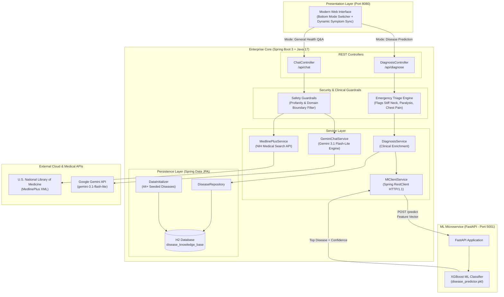

# 🏥 MediAI — Enterprise Clinical Intelligence Platform

[](https://www.oracle.com/java/)
[](https://spring.io/projects/spring-boot)
[](https://www.python.org/)
[](https://fastapi.tiangolo.com/)
[](https://xgboost.readthedocs.io/)
[](https://ai.google.dev/)
[](https://www.h2database.com/)

> **MediAI** is an enterprise-grade, polyglot clinical decision-support platform designed with a **Java 17 / Spring Boot 3** enterprise core and a **Python FastAPI / XGBoost** machine learning microservice. It features dual execution pipelines: deterministic, auditable machine-learning disease prediction with relational clinical knowledge enrichment, and evidence-grounded health consultation powered by the **U.S. National Library of Medicine (MedlinePlus)** and **Google Gemini 3.1**.

---

## 🏗️ System Architecture



---

## ⚡ Dual Execution Pipelines

### 1. Disease Prediction Pipeline (Deterministic & Auditable ML)
1. **Symptom Ingestion:** The user selects or types symptoms. Clicking any symptom tag directly populates the search bar.
2. **Clinical Triage Evaluation:** The `DiagnosisService` intercepts the input and scans for emergency red flags (`stiff_neck`, `paralysis`, `chest_pain`, `loss_of_consciousness`, `high_fever`).
3. **ML Microservice Invocation:** The Spring 6 `RestClient` calls the Python microservice (`POST http://127.0.0.1:5001/predict`) via standard HTTP/1.1.
4. **XGBoost Inference:** The model projects the 30 canonical features onto a binary vector and classifies across 45 infectious diseases.
5. **Relational Knowledge Enrichment:** Spring Data JPA queries `disease_knowledge_base` to retrieve the recommended **medical specialist**, **triage urgency**, **precautions**, and **home remedies**.
6. **Clinical Presentation:** Renders a clean diagnostic card with progress meters and specialist guidance.

### 2. Conversational Health Q&A Pipeline (Evidence-Grounded)
1. **Safety & Domain Guardrails:** The query passes through pre-compiled regex word-boundary filters and domain boundary assertions, rejecting profanity and irrelevant non-medical topics (coding, politics, etc.).
2. **Authoritative Grounding:** `MedlinePlusService` fetches verified health summaries from the **U.S. National Library of Medicine (NIH)** REST API, sanitizing escaped XML tags.
3. **Generative Clinical Reasoning:** `GeminiChatService` passes the user prompt along with grounding context to Google's **Gemini 3.1 Flash-Lite** under strict medical guardrail system prompts.
4. **Verified Delivery:** Responses are returned formatted in Markdown with official clinical citations.

---

## 🛡️ Clinical Safety & Enterprise Guardrails

| Guardrail Layer | Implementation | Purpose |
| :--- | :--- | :--- |
| **Emergency Triage Engine** | `DiagnosisService.java` | Detects life-threatening symptoms and immediately overrides triage state to `EMERGENCY`. |
| **Profanity & Content Filter** | Pre-compiled regex (`\\b...\\b`) | Intercepts vulgarity with $0\text{ms}$ latency without consuming external API tokens. |
| **Greeting Fast-Path** | Anchored regex (`^...$`) | Provides instant navigation without incurring LLM latency or cost. |
| **LLM Domain Boundary** | System prompt instructions | Restricts the generative AI exclusively to healthcare questions, politely rejecting out-of-scope topics. |
| **Anti-Hallucination Grounding** | `MedlinePlusService.java` | Synthesizes answers against live NIH clinical databases to guarantee scientific accuracy. |

---

## 🛠️ Tech Stack & Enterprise Design Patterns

### Backend (Spring Boot 3 Core)
- **Framework:** Spring Boot 3.2.4 (Java 17)
- **Architecture:** Controller-Service-Repository pattern with strongly typed DTOs
- **Database:** Spring Data JPA + H2 In-Memory Database (`jdbc:h2:mem:medibotdb`)
- **HTTP Client:** Spring 6 `RestClient` configured with `SimpleClientHttpRequestFactory` (HTTP/1.1)
- **Build System:** Apache Maven with Maven Wrapper (`./mvnw`)

### Machine Learning Microservice
- **Framework:** FastAPI with Uvicorn ASGI server (Port 5001)
- **Model:** Gradient Boosted Decision Trees (`XGBoostClassifier`, 45 disease classes, 30 symptom features)
- **Serialization:** `pickle` (`disease_predictor.pkl`)

### Frontend
- **Interface:** Modern medical UI (Vanilla HTML5 / CSS3 / ES6 JavaScript)
- **Features:** Floating bottom controls, dynamic symptom tag drawer with auto-close on submit, real-time typing indicators, and triage badges.

---

## 🗄️ Database Schema (`disease_knowledge_base`)

The H2 relational database is automatically seeded on startup via `DataInitializer.java` (`CommandLineRunner`) with 44 clinical disease profiles:

| Column | Type | Description |
| :--- | :--- | :--- |
| `id` | `BIGINT` (PK) | Auto-incrementing primary key |
| `disease_name` | `VARCHAR(255)` | Unique, case-insensitive disease name |
| `severity_level` | `VARCHAR(50)` | Clinical triage level: `Mild`, `Moderate`, `Emergency` |
| `specialist` | `VARCHAR(255)` | Recommended medical specialist (e.g. *Infectious Disease Specialist*, *Pulmonologist*) |
| `precautions` | `TEXT` | Official preventive and safety guidelines |
| `home_remedies` | `TEXT` | Evidence-based supportive care and hydration advice |
| `created_at` | `TIMESTAMP` | Record creation timestamp |

---

## 🚀 Getting Started

### Prerequisites
- **Java 17+** (JDK 17 or higher)
- **Python 3.10+** (with `pip`)
- **Google Gemini API Key** (Free from [Google AI Studio](https://aistudio.google.com/))

### 1. Clone the Repository
```bash
git clone https://github.com/praneethreddyyy30/Ai-medi-bot.git
cd Ai-medi-bot
```

### 2. Configure Environment Variables
Copy `.env.example` to `.env` in the root (or `ml-service/.env`):
```env
GEMINI_API_KEY=your_gemini_api_key_here
```

### 3. Install Python Dependencies
```bash
cd ml-service
pip install -r requirements.txt
cd ..
```

---

## 🏃 Running the Application

### Option A: One-Click Runner (Windows)
Double-click [`run_all.bat`](run_all.bat) or execute from the terminal:
```cmd
run_all.bat
```
This automatically boots both the Python ML microservice (Port 5001) and the Spring Boot backend (Port 8080).

### Option B: Manual Startup

**Terminal 1 — Python ML Microservice:**
```bash
cd ml-service
python ml_service.py
```
*Health Check:* [http://127.0.0.1:5001/health](http://127.0.0.1:5001/health)

**Terminal 2 — Spring Boot 3 Enterprise Core:**
```bash
cd spring-boot-backend
# Using Maven Wrapper (no pre-installed Maven required):
./mvnw spring-boot:run        # Linux/macOS
mvnw.cmd spring-boot:run      # Windows
```

---

## 🌐 Application Endpoints

| Resource | URL | Description |
| :--- | :--- | :--- |
| **Web Application** | [http://localhost:8080](http://localhost:8080) | Interactive MediAI Web Application |
| **H2 Database Console** | [http://localhost:8080/h2-console](http://localhost:8080/h2-console) | Database browser (JDBC URL: `jdbc:h2:mem:medibotdb`, User: `sa`, Password: `password`) |
| **Diagnosis API** | `POST http://localhost:8080/api/diagnose` | Predicts disease with ML & enriches with H2 clinical knowledge |
| **Chat API** | `POST http://localhost:8080/api/chat` | Conversational medical advice grounded in MedlinePlus & Gemini |
| **Supported Symptoms API** | `GET http://localhost:8080/api/features` | Returns canonical list of 30 clinical symptoms |
| **Python Health Check** | `GET http://localhost:5001/health` | Status and feature count of the XGBoost microservice |

---

## 📡 Sample API Requests

### 1. Disease Prediction
```bash
curl -X POST http://localhost:8080/api/diagnose \
  -H "Content-Type: application/json" \
  -d '{"symptoms": ["fever", "cough", "sore_throat"]}'
```

**Response:**
```json
{
  "predictedDisease": "Chlamydia",
  "confidence": 15.8,
  "specialistToConsult": "General Physician",
  "severityLevel": "Moderate",
  "homeRemedies": "Get plenty of rest, maintain hydration with warm fluids or ORS, and monitor symptoms.",
  "precautions": "Seek medical evaluation immediately if symptoms worsen or high fever persists.",
  "emergency": false,
  "allPredictions": [
    { "disease": "Chlamydia", "confidence": 15.8 },
    { "disease": "Rotavirus", "confidence": 7.94 },
    { "disease": "Hepatitis C", "confidence": 6.8 }
  ]
}
```

### 2. Clinical Health Q&A
```bash
curl -X POST http://localhost:8080/api/chat \
  -H "Content-Type: application/json" \
  -d '{"message": "What are the common symptoms and prevention steps for Dengue fever?"}'
```

---

## 📁 Repository Directory Structure

```
Ai-medi-bot/
├── spring-boot-backend/              # Java 17 + Spring Boot 3 Enterprise Core
│   ├── src/
│   │   ├── main/java/com/medibot/
│   │   │   ├── config/              # DataInitializer (H2 Database Seed)
│   │   │   ├── dto/                 # Strongly-typed Request/Response DTOs
│   │   │   ├── model/               # DiseaseInfo JPA Entity
│   │   │   ├── repository/          # Spring Data JPA DiseaseRepository
│   │   │   ├── service/             # Diagnosis, ML Client, Gemini, MedlinePlus
│   │   │   └── web/                 # DiagnosisController, ChatController
│   │   └── main/resources/
│   │       ├── application.properties
│   │       └── static/              # Modern UI (index.html, style.css, script.js)
│   ├── mvnw                         # Maven Wrapper (Unix)
│   ├── mvnw.cmd                     # Maven Wrapper (Windows)
│   └── pom.xml                      # Maven Build & Dependencies Configuration
├── ml-service/                      # Python ML Microservice
│   ├── ml_service.py                # FastAPI microservice on Port 5001
│   ├── disease_predictor.pkl        # Pre-trained 45-disease XGBoost model
│   ├── features.json                # Canonical 30 symptom features
│   ├── realistic_infectious_disease_dataset_45.csv
│   ├── train_test_final.py          # Model training pipeline
│   └── requirements.txt             # FastAPI, Uvicorn, XGBoost, Scikit-learn
├── run_all.bat                      # 1-Click launcher for both services
├── .env.example                     # Environment template for Gemini API key
├── .gitignore                       # Git ignore rules for build artifacts & keys
└── README.md                        # Enterprise project documentation
```

---

## ⚠️ Medical Disclaimer

**MediAI is a clinical decision-support demonstration tool and is NOT a substitute for professional medical judgment, diagnosis, or treatment.** Always advise patients and users to consult a qualified, licensed healthcare professional for personal medical conditions. In case of emergency, contact local emergency medical services immediately.

---

## 👨‍💻 Author & License

Developed by **Praneeth Reddy**  
Repository: [https://github.com/praneethreddyyy30/Ai-medi-bot](https://github.com/praneethreddyyy30/Ai-medi-bot)  
Licensed under the [MIT License](LICENSE).
