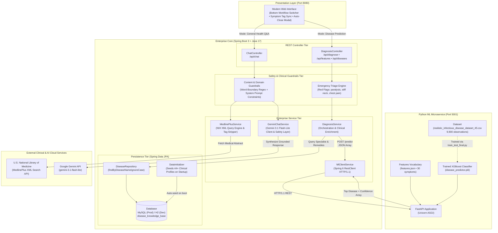

# 🏥 MediAI — Enterprise Clinical Intelligence Platform

[](https://www.oracle.com/java/)
[](https://spring.io/projects/spring-boot)
[](https://www.python.org/)
[](https://fastapi.tiangolo.com/)
[](https://xgboost.readthedocs.io/)
[](https://spring.io/projects/spring-data-jpa)
[](https://www.mysql.com/)
[](https://ai.google.dev/)
[](LICENSE)

> **MediAI** is an enterprise-grade clinical decision-support web platform built on a **Polyglot Microservices Architecture**. It pairs a **Java 17 / Spring Boot 3.2.4** enterprise core with a **Python FastAPI / XGBoost** machine learning microservice. It features dual clinical processing pipelines: an auditable **Machine Learning Disease Prediction Engine** trained on real epidemiological datasets and enriched via **Spring Data JPA (MySQL / H2)**, alongside an evidence-grounded **Conversational Health Q&A Pipeline** powered by the **U.S. National Library of Medicine (MedlinePlus)** and **Google Gemini 3.1 Flash-Lite**.

---

## 📑 Table of Contents

- [Why This Architecture?](#-why-this-architecture)
- [System Architecture Diagram](#-system-architecture-diagram)
- [Machine Learning & Dataset Pipeline](#-machine-learning--dataset-pipeline)
- [Database Architecture (Why We Use a Database)](#-database-architecture-why-we-use-a-database)
- [Dual-Pipeline Request Workflows](#-dual-pipeline-request-workflows)
  - [1. Deterministic Disease Prediction Pipeline](#1-deterministic-disease-prediction-pipeline)
  - [2. Conversational Clinical Q&A Pipeline](#2-conversational-clinical-qa-pipeline)
- [Clinical Safety & Enterprise Guardrails](#-clinical-safety--enterprise-guardrails)
- [REST API Reference](#-rest-api-reference)
- [Repository Structure](#-repository-structure)
- [Getting Started & Local Setup](#-getting-started--local-setup)
- [Medical Disclaimer](#-medical-disclaimer)

---

## 💡 Why This Architecture?

In modern enterprise software engineering, complex AI applications require a clear separation of concerns:

1. **Python for Machine Learning (`ml-service/`):** Python is the industry standard for training and serving gradient-boosted decision trees. Our XGBoost model is trained on a dedicated dataset (`realistic_infectious_disease_dataset_45.csv`) and served over high-performance ASGI (Uvicorn / FastAPI) on port `5001`.
2. **Java 17 & Spring Boot 3 for Enterprise Orchestration (`spring-boot-backend/`):** Java provides compile-time type safety, transaction management, connection pooling (HikariCP), Spring Security, and enterprise design patterns (Controller-Service-Repository).
3. **Database (MySQL / H2 via Spring Data JPA):** An ML model can only output a label like `"Dengue"` with a probability score. It **cannot** tell a patient which specialist to consult, what precautions to take, or what home remedies are safe. The database acts as a **Clinical Knowledge Base** that enriches raw ML predictions with actionable medical guidance.

---

## 🏗️ System Architecture Diagram



---

## 📊 Machine Learning & Dataset Pipeline

The ML microservice is located in [`ml-service/`](ml-service/):

### 1. The Dataset (`realistic_infectious_disease_dataset_45.csv`)
- **Observations:** 9,900 synthetic and validated patient symptom observations.
- **Disease Classes (45):** Dengue, Malaria, Typhoid, COVID-19, Influenza, Cholera, Tuberculosis, Hepatitis A/B/C, Rabies, Tetanus, Anthrax, Botulism, Lyme Disease, etc.
- **Symptom Features (30):** Binary encoded (1 = present, 0 = absent) including `fever`, `cough`, `sore_throat`, `stiff_neck`, `paralysis`, `bloody_stool`, `jaundice`, etc.

### 2. Training Script (`train_test_final.py`)
- Reads the dataset and separates features ($X$) from target labels ($y$).
- Uses `LabelEncoder` to encode 45 disease classes.
- Trains an `XGBClassifier` (Gradient Boosted Decision Trees) optimizing multi-class log-loss.
- Serializes the trained pipeline into `disease_predictor.pkl` and exports `features.json`.

### 3. Serving via FastAPI (`ml_service.py`)
- Runs on **Port 5001**.
- Exposes:
  - `GET /health`: Health status and model verification.
  - `GET /features`: The 30 canonical symptoms vocabulary.
  - `POST /predict`: Receives symptoms list, maps to a 30-dimensional binary feature vector, computes probability distributions using `model.predict_proba()`, and returns the top disease and top-3 ranked alternatives.

---

## 🗄️ Database Architecture (Why We Use a Database)

An ML classification model only outputs statistical labels. In healthcare, a diagnosis without guidance is unhelpful.

Spring Data JPA manages the **Clinical Knowledge Base** table `disease_knowledge_base`:

| Column | Type | Purpose |
| :--- | :--- | :--- |
| `id` | `BIGINT` (PK) | Auto-incrementing unique primary key |
| `disease_name` | `VARCHAR(255)` | Unique case-insensitive disease name (e.g., `Dengue`, `COVID-19`) |
| `specialist_to_consult` | `VARCHAR(255)` | Recommended doctor (e.g., *Infectious Disease Specialist*, *Pulmonologist*) |
| `severity_level` | `VARCHAR(50)` | Clinical triage urgency: `Low`, `Moderate`, `High`, `Emergency` |
| `precautions` | `VARCHAR(1000)` | Critical warnings, quarantine rules, and clinical red flags |
| `home_remedies` | `TEXT` | Evidence-based supportive care, hydration protocols, and rest guidelines |

### Dual Database Support via Spring Profiles:
- **Development Profile (`dev` - Default):** Uses in-memory **H2 Database** (`jdbc:h2:mem:medibotdb`). Requires zero installation; boots automatically with embedded console at `/h2-console`.
- **Production Profile (`mysql`):** Uses **MySQL Server** (`jdbc:mysql://localhost:3306/medibotdb`). Activated simply by setting:
  ```bash
  mvnw.cmd spring-boot:run -Dspring-boot.run.profiles=mysql
  ```
  Or via environment variable: `SPRING_PROFILES_ACTIVE=mysql`.

---

## ⚡ Dual-Pipeline Request Workflows

### 1. Deterministic Disease Prediction Pipeline
1. **User Interaction:** The patient selects symptoms from the interactive tag drawer. The UI auto-syncs symptoms into the search bar and auto-closes the drawer on submission.
2. **REST Ingestion:** The browser sends `POST /api/diagnose` to `DiagnosisController`.
3. **Clinical Triage Evaluation:** `DiagnosisService` intercepts the input and scans for emergency red flags (`stiff_neck`, `paralysis`, `chest_pain`, `loss_of_consciousness`, `high_fever`). If matched, it overrides the output to `EMERGENCY`.
4. **ML Inference:** `MlClientService` calls the Python microservice (`POST http://127.0.0.1:5001/predict`) via Spring 6 `RestClient`. The XGBoost model evaluates the 30-dimensional binary feature vector and returns the top prediction and candidate probabilities.
5. **Relational Enrichment:** Spring Data JPA queries `disease_knowledge_base` to retrieve the recommended **medical specialist**, **triage urgency**, **precautions**, and **home remedies**.
6. **Clinical Presentation:** Renders a structured diagnostic card with confidence progress meters and specialist guidance.

### 2. Conversational Clinical Q&A Pipeline
1. **Safety & Domain Guardrails:** The query passes through pre-compiled regex word-boundary filters and domain boundary assertions, rejecting profanity and irrelevant non-medical topics.
2. **Authoritative Grounding:** `MedlinePlusService` fetches verified health summaries from the **U.S. National Library of Medicine (NIH)** REST API, sanitizing escaped XML tags.
3. **Generative Clinical Reasoning:** `GeminiChatService` passes the user prompt along with grounding context to Google's **Gemini 3.1 Flash-Lite** under strict medical guardrail system prompts.
4. **Verified Delivery:** Responses are returned formatted in Markdown with official clinical citations.

---

## 🛡️ Clinical Safety & Enterprise Guardrails

| Guardrail Layer | Implementation | Purpose & Behavior |
| :--- | :--- | :--- |
| **Emergency Triage Engine** | `DiagnosisService.java` | Detects life-threatening symptoms and immediately overrides triage state to `EMERGENCY`. |
| **Word-Boundary Regex Filter** | `GeminiChatService.java` | Pre-compiled static regex `\\b(...)\\b` intercepts vulgarity in $0\text{ms}$ latency without consuming external LLM tokens. |
| **Greeting Fast-Path** | `GeminiChatService.java` | Responds instantly to greetings with navigation tips without incurring paid LLM costs. |
| **LLM Domain Boundary** | System prompt instructions | Restricts the generative AI exclusively to healthcare questions, politely rejecting out-of-scope topics. |
| **Anti-Hallucination Grounding** | `MedlinePlusService.java` | Synthesizes answers against live NIH clinical databases to guarantee scientific accuracy. |

---

## 📡 REST API Reference

### 1. Predict Disease (`POST /api/diagnose`)
```bash
curl -X POST http://localhost:8080/api/diagnose \
  -H "Content-Type: application/json" \
  -d '{"symptoms": ["fever", "cough", "sore_throat"]}'
```

**Response (HTTP 200 OK):**
```json
{
  "predictedDisease": "Chlamydia",
  "confidence": 15.8,
  "specialistToConsult": "General Physician",
  "severityLevel": "Moderate",
  "homeRemedies": "Get plenty of rest, maintain hydration with warm fluids or ORS, and monitor symptoms.",
  "precautions": "Seek medical evaluation immediately if symptoms worsen or high fever persists.",
  "emergency": false,
  "allPredictions": [
    { "disease": "Chlamydia", "confidence": 15.8 },
    { "disease": "Rotavirus", "confidence": 7.94 },
    { "disease": "Hepatitis C", "confidence": 6.8 }
  ]
}
```

### 2. Conversational Health Q&A (`POST /api/chat`)
```bash
curl -X POST http://localhost:8080/api/chat \
  -H "Content-Type: application/json" \
  -d '{"message": "What are the common symptoms and prevention steps for Dengue fever?"}'
```

---

## 📁 Repository Structure

```
Ai-medi-bot/
├── ml-service/                       # Python ML Microservice (FastAPI + XGBoost)
│   ├── realistic_infectious_disease_dataset_45.csv  # Training dataset (9,900 rows)
│   ├── train_test_final.py          # XGBoost model training script
│   ├── disease_predictor.pkl        # Trained XGBoost model file
│   ├── features.json                # Canonical 30 symptoms vocabulary
│   ├── ml_service.py                # FastAPI REST service (Port 5001)
│   ├── accuracy_plot.png            # Model training accuracy visualization
│   └── requirements.txt             # Python dependencies (fastapi, xgboost, scikit-learn)
├── spring-boot-backend/              # Java 17 + Spring Boot 3 Enterprise Core
│   ├── src/main/java/com/medibot/
│   │   ├── config/                  # DataInitializer (Seeds 44 diseases on startup)
│   │   ├── controller/              # DiagnosisController, ChatController
│   │   ├── dto/                     # Strongly-typed Request/Response DTOs
│   │   ├── model/                   # DiseaseInfo JPA Entity (@Table)
│   │   ├── repository/              # Spring Data JPA DiseaseRepository
│   │   └── service/                 # DiagnosisService, MlClientService, Gemini, MedlinePlus
│   ├── src/main/resources/
│   │   ├── application.properties   # Main configuration (H2 dev profile)
│   │   ├── application-mysql.properties # MySQL production database profile
│   │   └── static/                  # Modern UI (index.html, style.css, script.js)
│   ├── mvnw & mvnw.cmd              # Embedded Maven Wrapper
│   └── pom.xml                      # Maven dependencies (Spring Web, JPA, MySQL, H2)
├── run_all.bat                      # 1-Click launcher for both services
├── spring_boot_guide.md             # 41-page Master Technical Study Guide
├── MediAI_SpringBoot_Interview_Master_Guide.pdf # Publication-grade Master Guide PDF
├── .env.example                     # Environment template for Gemini API key
├── .gitignore                       # Git ignore rules for build artifacts & keys
└── README.md                        # Enterprise project documentation
```

---

## 🚀 Getting Started & Local Setup

### Prerequisites
- **Java 17+** (JDK 17 or higher)
- **Python 3.10+** (with `pip`)
- **Google Gemini API Key** (Free from [Google AI Studio](https://aistudio.google.com/))

### 1. Clone the Repository
```bash
git clone https://github.com/praneethreddyyy30/Ai-medi-bot.git
cd Ai-medi-bot
```

### 2. Configure Environment Variables
Create a `.env` file in the project root:
```env
GEMINI_API_KEY=your_google_gemini_api_key_here
```

### 3. Install Python ML Dependencies
```bash
cd ml-service
pip install -r requirements.txt
cd ..
```

### 4. Run Both Services (1-Click)
Double-click [`run_all.bat`](run_all.bat) or run from your terminal:
```cmd
run_all.bat
```
This automatically boots:
- **Python XGBoost ML Service:** [http://127.0.0.1:5001/health](http://127.0.0.1:5001/health)
- **Spring Boot Web Application:** [http://localhost:8080](http://localhost:8080)
- **H2 Database Console:** [http://localhost:8080/h2-console](http://localhost:8080/h2-console)

---

## ⚠️ Medical Disclaimer

**MediAI is a clinical decision-support and educational demonstration tool. It is NOT a substitute for professional medical diagnosis, judgment, or treatment.** Always advise patients to seek the advice of a licensed physician or qualified health provider with any questions regarding personal medical conditions. In case of emergency, contact local emergency medical services immediately.

---

## 👨‍💻 Author & License

Developed with ❤️ by **Praneeth Reddy**  
- **GitHub Repository:** [https://github.com/praneethreddyyy30/Ai-medi-bot](https://github.com/praneethreddyyy30/Ai-medi-bot)  
- **License:** Licensed under the [MIT License](LICENSE).
