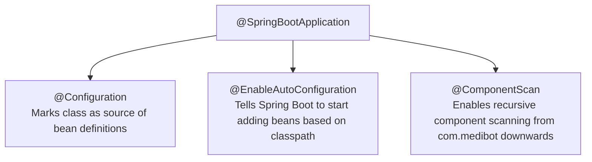
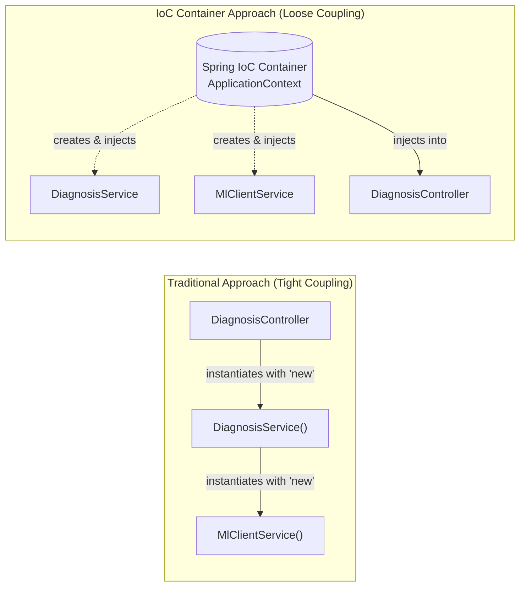
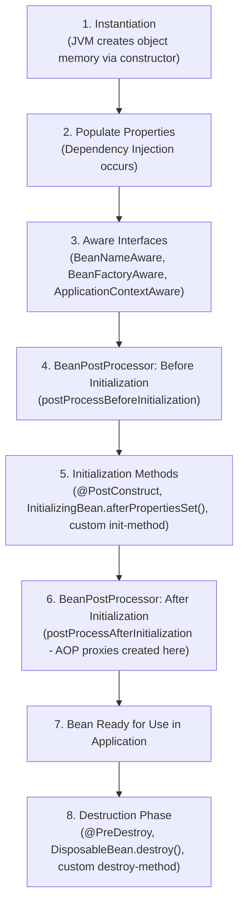
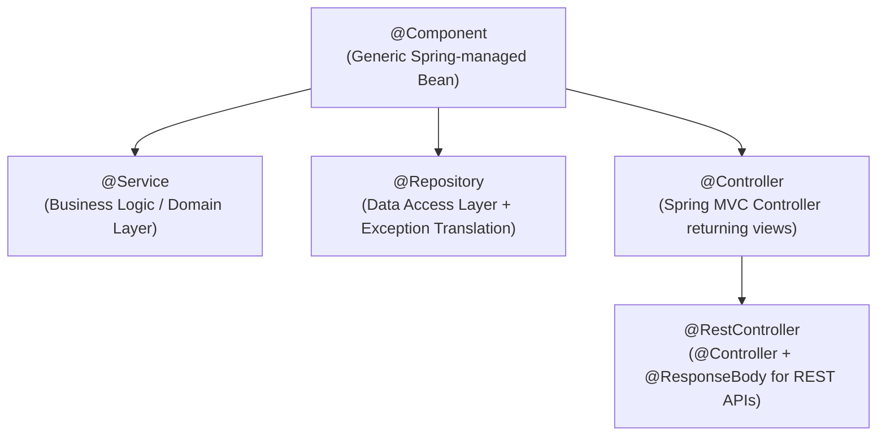
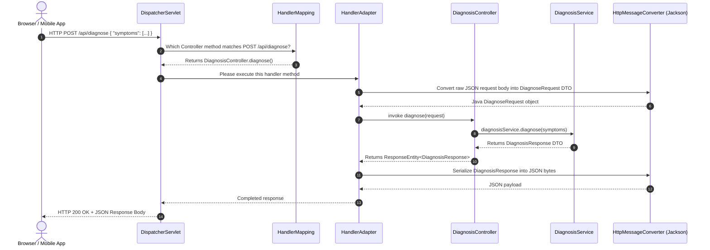
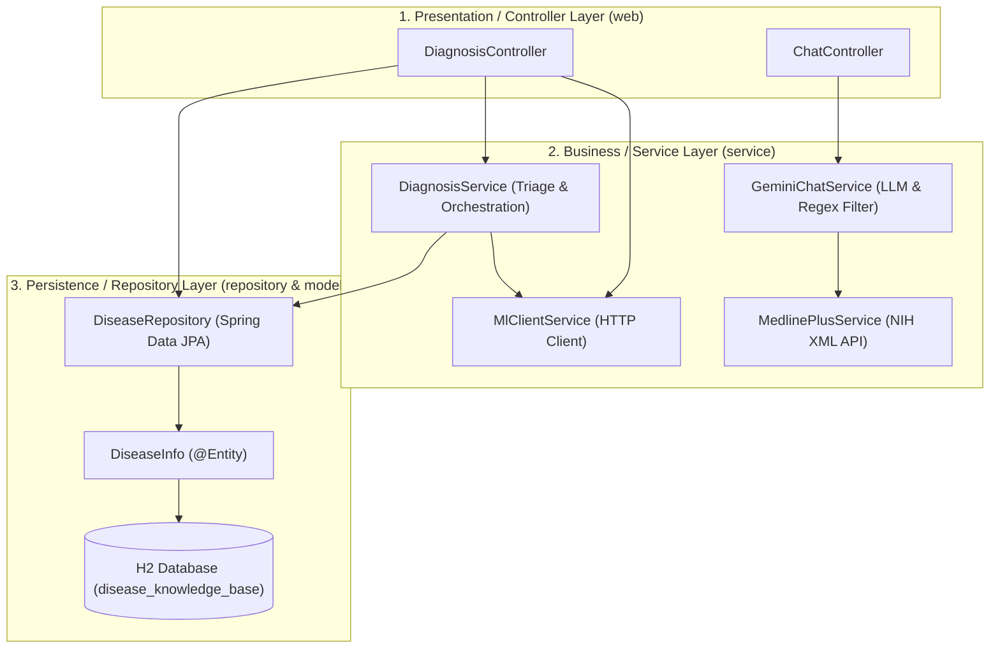
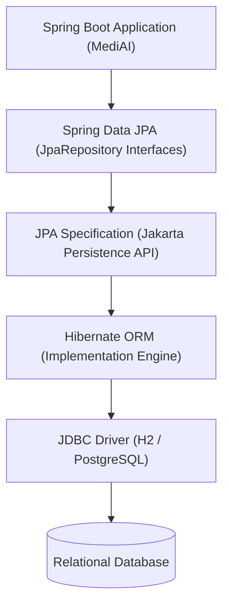
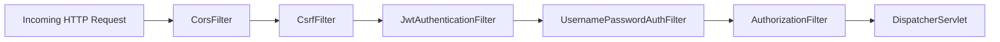

# MediAI — Enterprise Spring Boot 3 & Machine Learning Architecture
## The Complete Master Study Guide & Interview Manual for Java Full Stack Developers

---

# PART 1: Core Spring Framework & Spring Boot Foundations

## 1.1 What is Spring Framework and What Problem Did It Solve?

### The Real-World Analogy
Imagine building a modern automobile. In the early days of automotive engineering, if you wanted an engine, transmission, brakes, and suspension, you had to manually forge every screw, weld every joint, and hard-wire every mechanical linkage yourself. If you decided to swap a 4-cylinder engine for a 6-cylinder engine, you would have to dismantle the entire chassis because all components were rigidly fused together.

In enterprise Java prior to 2003, developers faced the exact same nightmare with **Enterprise JavaBeans (EJB 2.x)**. To write a simple business application, you had to write complex XML deployment descriptors, implement heavy container-specific interfaces, handle low-level transactions manually, and manage class lifecycles yourself. Your business logic was tightly coupled to heavy, expensive application servers (such as IBM WebSphere or BEA WebLogic).

### Technical Definition
The **Spring Framework**, created by Rod Johnson in 2003, revolutionized Java development by introducing a lightweight, non-invasive application framework based on two foundational principles:
1. **Plain Old Java Objects (POJOs):** You write clean, simple Java classes without being forced to implement proprietary enterprise interfaces.
2. **Inversion of Control (IoC) & Dependency Injection (DI):** Instead of classes constructing their own dependencies, an external container creates and wires them together.

Spring provided out-of-the-box infrastructure for transaction management, database connectivity (JDBC/ORM), security, messaging, and MVC web applications, allowing developers to focus purely on business logic.

---

## 1.2 Spring Framework vs. Spring Boot: The Evolution

While the original Spring Framework solved architectural coupling, it created a new problem: **Configuration Hell** (often nicknamed *"XML Hell"*).

To build even a basic "Hello World" REST API in classic Spring MVC, a developer had to:
- Configure `web.xml` to declare the `DispatcherServlet`.
- Configure `applicationContext.xml` to define data sources, transaction managers, and component scanning.
- Manually configure compatible JAR dependency versions in `pom.xml` (e.g., matching Hibernate 5.2 with Spring 5.0 and Jackson 2.8 without version mismatch crashes).
- Install, configure, and manage a standalone servlet container such as Apache Tomcat.
- Package the project as a `.war` file and deploy it into Tomcat.

### Enter Spring Boot (2014)
**Spring Boot** does not replace Spring Framework; rather, it is a sophisticated, opinionated umbrella built **on top of** Spring Framework. Spring Boot eliminates boilerplate setup through three core pillars:

| Capability | Classic Spring Framework | Spring Boot 3 |
| :--- | :--- | :--- |
| **Configuration** | Heavy manual XML or complex `@Configuration` classes | **Auto-Configuration:** Pre-configures 90% of beans automatically based on classpath dependencies |
| **Dependency Management** | Manual individual dependency versions with frequent version collisions | **Starter Dependencies (`spring-boot-starter-*`):** Curated, battle-tested dependency bundles with managed BOM (Bill of Materials) |
| **Server Deployment** | Standalone servlet container required (Deploy `.war` to Tomcat/JBoss) | **Embedded Web Server:** Embedded Apache Tomcat packaged directly inside executable `.jar` |
| **Production Readiness** | Custom health check scripts, manual JMX metrics | **Spring Boot Actuator:** Out-of-the-box `/actuator/health`, metrics, and info endpoints |
| **Bootstrap Entry Point** | `web.xml` servlet mapping | A standard `public static void main(String[] args)` Java method |

---

## 1.3 Convention Over Configuration & Opinionated Defaults

"Convention over Configuration" is a software design paradigm where a framework provides sensible, battle-tested defaults ("conventions"). You only need to write configuration when you intentionally want to deviate from those defaults.

### How This Applies in MediAI:
When our MediAI project includes `spring-boot-starter-data-jpa` and the `h2` database dependency, Spring Boot makes the following opinionated decisions without us writing a single line of XML or Java configuration:
- It discovers H2 on the classpath and automatically configures an in-memory `HikariDataSource` connection pool.
- It detects Hibernate and automatically configures a `LocalContainerEntityManagerFactoryBean`.
- It sets the dialect to `org.hibernate.dialect.H2Dialect`.
- It registers an in-memory H2 transaction manager (`JpaTransactionManager`).

If we want to change this behavior (for example, pointing to PostgreSQL in production), we override only that specific convention in `application.properties`.

---

## 1.4 How Spring Boot Auto-Configuration Works Internally

Auto-configuration is often described as "magic," but it is actually a deterministic Java condition-evaluation mechanism.

### The Internal Mechanism:
1. When you run `SpringApplication.run(MediBotApplication.class, args)`, Spring Boot scans your classpath for a special file located at:
   `META-INF/spring/org.springframework.boot.autoconfigure.AutoConfiguration.imports` (in Spring Boot 3)
2. This file contains a list of hundreds of auto-configuration classes (e.g., `DataSourceAutoConfiguration`, `HibernateJpaAutoConfiguration`, `DispatcherServletAutoConfiguration`).
3. Each auto-configuration class is guarded by **Conditional Annotations**:
   - `@ConditionalOnClass(DataSource.class)`: Run this auto-configuration *only* if `DataSource` is present on the classpath.
   - `@ConditionalOnMissingBean(DataSource.class)`: Create this default data source *only* if the developer has not already declared their own `@Bean DataSource`.
   - `@ConditionalOnProperty(name = "spring.h2.console.enabled", havingValue = "true")`: Activate the H2 web console *only* if the user explicitly enabled it in `application.properties`.

This ensures that Spring Boot provides default beans while always yielding priority to developer-defined custom configurations.

---

## 1.5 Starter Dependencies Explained

A "Starter" is a composite Maven/Gradle descriptor that aggregates all related dependencies, transitive libraries, and compatible version numbers into a single import.

In MediAI's [`pom.xml`](file:///c:/Users/saipr/Downloads/Ai-medi-bot-main/spring-boot-backend/pom.xml):
```xml
<!-- 1. Web Starter: Bundles Spring MVC, REST support, Jackson JSON, and embedded Tomcat -->
<dependency>
    <groupId>org.springframework.boot</groupId>
    <artifactId>spring-boot-starter-web</artifactId>
</dependency>

<!-- 2. JPA Starter: Bundles Hibernate ORM, Spring Data JPA, HikariCP, and JDBC -->
<dependency>
    <groupId>org.springframework.boot</groupId>
    <artifactId>spring-boot-starter-data-jpa</artifactId>
</dependency>

<!-- 3. Validation Starter: Bundles Jakarta Validation API and Hibernate Validator -->
<dependency>
    <groupId>org.springframework.boot</groupId>
    <artifactId>spring-boot-starter-validation</artifactId>
</dependency>
```
Notice that none of these dependencies specify a `<version>` tag. The version is centrally governed by the parent `spring-boot-starter-parent` (version `3.2.4`), ensuring 100% binary compatibility across all libraries and preventing "JAR hell."

---

## 1.6 Embedded Web Servers: How Tomcat Runs Inside a JAR

In classic Java EE, Tomcat was the host and your application was a guest packaged inside a `.war` file.

In Spring Boot, the paradigm is inverted: **your application is the host, and Tomcat is a library dependency.**
When `spring-boot-starter-web` is on the classpath:
1. Spring Boot instantiates an embedded `TomcatWebServer` object programmatically in memory.
2. It binds an HTTP connector to port `8080` (or `server.port` specified in `application.properties`).
3. It mounts the `DispatcherServlet` to `/` (the root context).
4. The entire application compiles into a single, self-contained, executable "Fat JAR" containing all compiled classes, resources, and dependencies.

You run it simply with:
```bash
java -jar ai-medi-bot-backend.jar
```
This is ideal for containerized Docker deployments and Kubernetes microservices.

---

## 1.7 Dissecting `@SpringBootApplication`

In MediAI, our main entry point is [`MediBotApplication.java`](file:///c:/Users/saipr/Downloads/Ai-medi-bot-main/spring-boot-backend/src/main/java/com/medibot/MediBotApplication.java):

```java
package com.medibot;

import org.springframework.boot.SpringApplication;
import org.springframework.boot.autoconfigure.SpringBootApplication;

@SpringBootApplication
public class MediBotApplication {

    public static void main(String[] args) {
        SpringApplication.run(MediBotApplication.class, args);
        System.out.println("=================================================");
        System.out.println("🚀 AI Medi Bot Enterprise Backend is LIVE on Port 8080");
        System.out.println("📊 H2 Database Console: http://localhost:8080/h2-console");
        System.out.println("🩺 API Endpoint: http://localhost:8080/api/diagnose");
        System.out.println("=================================================");
    }
}
```

The `@SpringBootApplication` annotation is a **composite convenience annotation** that bundles three critical annotations:



1. **`@Configuration`:** Designates this class as a source of bean definitions for the Spring IoC container.
2. **`@EnableAutoConfiguration`:** Activates Spring Boot's auto-configuration engine to automatically provision infrastructure beans.
3. **`@ComponentScan`:** Instructs Spring to recursively scan the current package (`com.medibot`) and all its sub-packages (`com.medibot.controller`, `com.medibot.service`, `com.medibot.repository`, `com.medibot.config`) for classes marked with `@Component`, `@Service`, `@Repository`, or `@RestController`.

---

# PART 2: Inversion of Control (IoC), Dependency Injection (DI) & Bean Management

## 2.1 Inversion of Control (IoC): The Architectural Shift

### The Real-World Analogy: The "Hollywood Principle"
In traditional programming, class `A` controls its own destiny: if it needs an instance of class `B`, it writes `new B()`. This is like an actor constantly knocking on every movie director's door asking for work.

**Inversion of Control (IoC)** inverts that control flow following the Hollywood Principle: *"Don't call us, we'll call you."*
Instead of a class instantiating its dependencies, the **Spring IoC Container** takes control. The container instantiates the dependencies, manages their lifecycle, and injects them into the classes that require them.



### Why Does This Matter?
- **Loose Coupling:** `DiagnosisController` does not care how `DiagnosisService` is configured or created.
- **Unit Testability:** In a unit test, you can pass a mock `DiagnosisService` to `DiagnosisController` without spinning up a database or ML service.
- **Single Responsibility:** Classes focus purely on their core business logic rather than object construction plumbing.

---

## 2.2 What is a Spring Bean?

A **Spring Bean** is simply a Java object that is instantiated, assembled, configured, and managed by the Spring IoC container.

Any regular Java class (POJO) becomes a Spring Bean when:
1. It is annotated with a stereotype annotation such as `@Component`, `@Service`, `@Repository`, or `@RestController`.
2. OR it is explicitly instantiated in a `@Configuration` class via a method annotated with `@Bean`.

### Bean Scopes:
Spring supports several bean scopes, governed by the `@Scope` annotation:
- **Singleton (Default):** Exactly one shared instance is created per Spring `ApplicationContext`. Every class that requests this bean gets a reference to the exact same object. All services in MediAI (`DiagnosisService`, `MlClientService`, `GeminiChatService`) are singletons.
- **Prototype:** A brand-new instance is created every single time the bean is requested.
- **Request (Web-aware):** One instance per HTTP request lifecycle.
- **Session (Web-aware):** One instance per HTTP session lifecycle.

---

## 2.3 The Spring Bean Lifecycle

Understanding the bean lifecycle is a favorite topic in technical interviews:



In MediAI, when `DataInitializer` runs on application startup:
1. Spring instantiates `DataInitializer(DiseaseRepository diseaseRepository)`.
2. Spring injects the `DiseaseRepository` proxy instance.
3. Spring completes initialization.
4. Because `DataInitializer` implements `CommandLineRunner`, Spring calls its `run(String... args)` method right before the application begins accepting HTTP requests, ensuring all 44 diseases are seeded into H2.

---

## 2.4 `BeanFactory` vs. `ApplicationContext`

Both are interfaces representing the Spring IoC container, but with crucial enterprise distinctions:

| Feature | `BeanFactory` | `ApplicationContext` |
| :--- | :--- | :--- |
| **Hierarchy** | Root interface of the IoC container (`org.springframework.beans.factory`) | Extends `BeanFactory` (`org.springframework.context`) |
| **Bean Loading** | **Lazy Loading:** Instantiates beans only when `getBean()` is called. | **Eager / Pre-loading:** Instantiates all singleton beans at startup. |
| **Resource Usage** | Lightweight (suitable for resource-constrained memory devices). | Rich enterprise features (recommended for all modern web applications). |
| **Enterprise Features** | Basic DI only. | Internationalization (i18n), Event Publishing, AOP integration, WebApplicationContext. |

**In MediAI:** Spring Boot uses `AnnotationConfigServletWebServerApplicationContext`, a specialized `ApplicationContext` that manages web components and boots the embedded Tomcat server.

---

## 2.5 Dependency Injection Mechanisms: Constructor vs. Field vs. Setter

There are three ways to inject dependencies in Spring:

### 1. Field Injection (Using `@Autowired` directly on private fields)
```java
// ⚠️ ANTI-PATTERN - NOT RECOMMENDED
@RestController
public class DiagnosisController {

    @Autowired
    private DiagnosisService diagnosisService;
    
    // ...
}
```
**Why Field Injection is Discouraged:**
- **Hides Dependencies:** It is not obvious from the class signature what dependencies are required.
- **Breaks Unit Testing:** You cannot instantiate `DiagnosisController` in a JUnit test with `new DiagnosisController()` because the field is private; you must use slow reflection or mockito runner.
- **Cannot Make Fields `final`:** Prevents immutability.
- **Prone to NullPointerExceptions:** If instantiated outside Spring, the field remains null.

### 2. Setter Injection
```java
@RestController
public class DiagnosisController {

    private DiagnosisService diagnosisService;

    @Autowired
    public void setDiagnosisService(DiagnosisService diagnosisService) {
        this.diagnosisService = diagnosisService;
    }
}
```
**Use Case:** Good for optional dependencies that can be reconfigured or changed at runtime.

### 3. Constructor Injection (Enterprise Best Practice — Used Across MediAI)
```java
@RestController
@RequestMapping("/api")
@CrossOrigin(origins = "*")
public class DiagnosisController {

    private final DiagnosisService diagnosisService;
    private final MlClientService mlClientService;
    private final DiseaseRepository diseaseRepository;

    // Constructor Injection (Spring automatically injects all parameters)
    public DiagnosisController(DiagnosisService diagnosisService,
                               MlClientService mlClientService,
                               DiseaseRepository diseaseRepository) {
        this.diagnosisService = diagnosisService;
        this.mlClientService = mlClientService;
        this.diseaseRepository = diseaseRepository;
    }
    // ...
}
```

**Why Constructor Injection is Superior:**
1. **Immutability:** Dependencies can be marked `final`, ensuring they are never reassigned after construction.
2. **Fail-Fast at Startup:** If a required bean is missing, the JVM fails immediately on startup with a descriptive error rather than throwing a `NullPointerException` at runtime.
3. **Painless Testing:** You can write pure JUnit 5 tests without Spring test runners:
   ```java
   DiagnosisService mockService = Mockito.mock(DiagnosisService.class);
   DiagnosisController controller = new DiagnosisController(mockService, mockMl, mockRepo);
   ```
4. **No `@Autowired` Required:** In Spring 4.3+, if a class has a single constructor, Spring automatically injects dependencies without needing the `@Autowired` annotation.

---

# PART 3: Stereotype Annotations & Layered Architecture

## 3.1 The Stereotype Hierarchy

In Spring, stereotype annotations mark classes as Spring-managed beans and express their architectural role:



---

## 3.2 Comparison of Stereotypes in MediAI

### 1. `@Component`
The generic meta-annotation. Used for utility classes, scheduled jobs, or startup runners.
- **In MediAI:** Used on [`DataInitializer.java`](file:///c:/Users/saipr/Downloads/Ai-medi-bot-main/spring-boot-backend/src/main/java/com/medibot/config/DataInitializer.java#L13):
  ```java
  @Component
  public class DataInitializer implements CommandLineRunner { ... }
  ```

### 2. `@Service`
Specializes `@Component` to indicate business logic, calculations, domain transactions, and orchestration.
- **In MediAI:** Used on:
  - [`DiagnosisService.java`](file:///c:/Users/saipr/Downloads/Ai-medi-bot-main/spring-boot-backend/src/main/java/com/medibot/service/DiagnosisService.java#L20) (Clinical triage and decision logic)
  - [`MlClientService.java`](file:///c:/Users/saipr/Downloads/Ai-medi-bot-main/spring-boot-backend/src/main/java/com/medibot/service/MlClientService.java#L18) (HTTP client calling Python FastAPI)
  - [`GeminiChatService.java`](file:///c:/Users/saipr/Downloads/Ai-medi-bot-main/spring-boot-backend/src/main/java/com/medibot/service/GeminiChatService.java#L17) (LLM generative chat & safety filters)
  - [`MedlinePlusService.java`](file:///c:/Users/saipr/Downloads/Ai-medi-bot-main/spring-boot-backend/src/main/java/com/medibot/service/MedlinePlusService.java#L16) (NIH MedlinePlus XML retrieval and parsing)

### 3. `@Repository`
Specializes `@Component` for data access classes (DAOs/Repositories).
- **Special Feature:** Automatically activates Spring's **PersistenceExceptionTranslationPostProcessor**, which catches vendor-specific SQL exceptions (like `SQLException` or `HibernateException`) and converts them into Spring's unified, unchecked `DataAccessException` hierarchy.
- **In MediAI:** Used on [`DiseaseRepository.java`](file:///c:/Users/saipr/Downloads/Ai-medi-bot-main/spring-boot-backend/src/main/java/com/medibot/repository/DiseaseRepository.java#L12):
  ```java
  @Repository
  public interface DiseaseRepository extends JpaRepository<DiseaseInfo, Long> { ... }
  ```

### 4. `@Controller` vs. `@RestController`
- `@Controller`: Used in traditional server-rendered web applications (e.g., Thymeleaf, JSP) where methods return view template names (Strings like `"index"` or `"home.html"`).
- `@RestController`: A convenience annotation combining `@Controller` and `@ResponseBody`. Every handler method automatically serializes return values directly into JSON/XML via Jackson and writes them to the HTTP response body.
- **In MediAI:** Used on [`DiagnosisController.java`](file:///c:/Users/saipr/Downloads/Ai-medi-bot-main/spring-boot-backend/src/main/java/com/medibot/controller/DiagnosisController.java#L19) and [`ChatController.java`](file:///c:/Users/saipr/Downloads/Ai-medi-bot-main/spring-boot-backend/src/main/java/com/medibot/controller/ChatController.java#L12):
  ```java
  @RestController
  @RequestMapping("/api")
  public class DiagnosisController { ... }
  ```

---

# PART 4: Configuration & Externalized Properties

## 4.1 Configuration Annotations: `@Configuration` and `@Bean`

When you want to register third-party classes (such as an HTTP client, security filter, or Jackson ObjectMapper) that you did not write and cannot annotate with `@Component`, you use a `@Configuration` class:

```java
@Configuration
public class AppConfig {

    @Bean
    public RestClient customRestClient() {
        SimpleClientHttpRequestFactory factory = new SimpleClientHttpRequestFactory();
        factory.setConnectTimeout(5000);
        factory.setReadTimeout(5000);
        return RestClient.builder()
                .requestFactory(factory)
                .build();
    }
}
```
- `@Configuration`: Marks the class as a bean definition factory. Spring CGLIB proxies this class so that calling `@Bean` methods repeatedly returns the same singleton bean instance.
- `@Bean`: Marks the method's return value as a managed Spring bean.

---

## 4.2 Injecting Properties with `@Value`

The `@Value` annotation injects property values from `application.properties`, environment variables, or system properties into bean fields or constructor parameters.

### How MediAI Uses `@Value` in [`GeminiChatService.java`](file:///c:/Users/saipr/Downloads/Ai-medi-bot-main/spring-boot-backend/src/main/java/com/medibot/service/GeminiChatService.java#L25):
```java
@Service
public class GeminiChatService {

    private final String apiKey;

    // Injects property 'gemini.api.key'; if not defined, defaults to an empty string ("")
    public GeminiChatService(@Value("${gemini.api.key:}") String apiKey, 
                             MedlinePlusService medlinePlusService) {
        this.apiKey = apiKey;
        // ...
    }
}
```
And in [`MlClientService.java`](file:///c:/Users/saipr/Downloads/Ai-medi-bot-main/spring-boot-backend/src/main/java/com/medibot/service/MlClientService.java#L24):
```java
// Injects 'ml.service.url'; if not defined, defaults to "http://127.0.0.1:5001"
public MlClientService(@Value("${ml.service.url:http://127.0.0.1:5001}") String mlServiceUrl) {
    this.mlServiceUrl = mlServiceUrl;
    // ...
}
```

---

## 4.3 `@ConfigurationProperties` for Type-Safe Hierarchical Configuration

For large configuration blocks, `@Value` becomes repetitive. `@ConfigurationProperties` binds an entire group of properties to a strongly typed POJO:

```java
@Configuration
@ConfigurationProperties(prefix = "mediai.ml")
public class MlServiceProperties {
    private String url = "http://127.0.0.1:5001";
    private int timeout = 5000;
    private int retryCount = 3;

    // Getters and Setters...
}
```
Properties in `application.properties`:
```properties
mediai.ml.url=http://production-ml-cluster:5001
mediai.ml.timeout=8000
mediai.ml.retry-count=5
```

---

## 4.4 `application.properties` vs. `application.yml`

Spring Boot supports both formats:
- **`application.properties`:** Flat key-value pairs (`server.port=8080`). Easier to override via environment variables.
- **`application.yml` (YAML):** Hierarchical, indent-based, human-readable structure, supports lists and multi-document files.

### Full Dissection of MediAI's [`application.properties`](file:///c:/Users/saipr/Downloads/Ai-medi-bot-main/spring-boot-backend/src/main/resources/application.properties):

```properties
# 1. Server Configuration
server.port=8080                          # Configures Tomcat to listen on HTTP port 8080

# 2. Application Identifier
spring.application.name=ai-medi-bot-backend

# 3. H2 In-Memory Database Configuration
# DB_CLOSE_DELAY=-1 keeps the in-memory database alive as long as the JVM is running
# DB_CLOSE_ON_EXIT=FALSE prevents premature database shutdown during JVM hooks
spring.datasource.url=jdbc:h2:mem:medibotdb;DB_CLOSE_DELAY=-1;DB_CLOSE_ON_EXIT=FALSE
spring.datasource.driverClassName=org.h2.Driver
spring.datasource.username=sa
spring.datasource.password=password

# 4. JPA / Hibernate Configuration
spring.jpa.database-platform=org.hibernate.dialect.H2Dialect
spring.jpa.hibernate.ddl-auto=update       # Automatically generates/updates table schema on startup
spring.jpa.show-sql=false                  # Set to true to print raw SQL queries to console during debugging
spring.jpa.properties.hibernate.format_sql=true

# 5. H2 Web Management Console
spring.h2.console.enabled=true             # Activates browser UI at http://localhost:8080/h2-console
spring.h2.console.path=/h2-console
spring.h2.console.settings.web-allow-others=true

# 6. Microservice & External Cloud Endpoints
ml.service.url=http://127.0.0.1:5001       # Python FastAPI XGBoost Microservice
gemini.api.key=${GEMINI_API_KEY:}          # Reads environment variable GEMINI_API_KEY securely
```

---

## 4.5 Spring Profiles: Managing Environments (Dev, Test, Prod)

Profiles allow you to segregate your configuration for different deployment environments.
- `application-dev.properties`: In-memory H2 database, verbose SQL logging (`show-sql=true`).
- `application-prod.properties`: AWS RDS PostgreSQL database, connection pooling with 50 connections, no console logging.

Activate profiles via:
```properties
# In application.properties:
spring.profiles.active=prod
```
Or via CLI argument:
```bash
java -jar app.jar --spring.profiles.active=prod
```
Or via Environment Variable:
```bash
export SPRING_PROFILES_ACTIVE=prod
```

---

# PART 5: Spring MVC & Request Processing Lifecycle

## 5.1 What is Spring MVC?

Spring MVC is an implementation of the **Model-View-Controller** design pattern built around a central servlet called the **`DispatcherServlet`**.
- **Model:** Represents the domain data and business state (Entities and DTOs).
- **View:** The user interface (in MediAI, our modern single-page HTML5/CSS3 frontend).
- **Controller:** Interprets user inputs, coordinates with services, and returns responses.

---

## 5.2 The `DispatcherServlet` & Front Controller Pattern

The **Front Controller Pattern** centralizes request handling through a single entry point. Rather than mapping dozens of independent servlets for every URL, **one** central servlet (`DispatcherServlet`) intercepts all incoming HTTP traffic.

### The Complete 7-Step Request Processing Flow:



---

## 5.3 Three-Tier Layered Architecture in MediAI

MediAI strictly adheres to the enterprise Three-Tier architectural pattern:



### Why Strictly Separate Layers?
1. **Controller Layer:** Purely responsible for HTTP concerns (request routing, status codes, JSON deserialization, input validation). **Never write SQL or business calculations here.**
2. **Service Layer:** Purely responsible for business logic, triage rules, calculations, and coordinating between repositories and external microservices.
3. **Repository Layer:** Purely responsible for database interactions (CRUD, custom queries).


---

# PART 6: RESTful API Design & HTTP Semantics

## 6.1 RESTful Web Services & Architectural Constraints

**REST** (Representational State Transfer) is an architectural style for networked hypermedia applications. A true RESTful API adheres to six core constraints:
1. **Client-Server Architecture:** Separation of user interface concerns from data storage concerns.
2. **Statelessness:** Every request from client to server must contain all of the information necessary to understand and complete the request. The server never stores client session state between requests.
3. **Cacheability:** Responses must implicitly or explicitly define themselves as cacheable or non-cacheable.
4. **Uniform Interface:** Identification of resources using URIs (e.g., `/api/diseases/{name}`) and standard HTTP methods.
5. **Layered System:** The client cannot tell whether it is connected directly to the end server or to an intermediary (API Gateway, load balancer).
6. **Code on Demand (Optional):** Servers can temporarily extend client functionality by transferring executable code.

---

## 6.2 Spring REST Routing Annotations

### `@RequestMapping`
The master routing annotation. It maps HTTP requests to handler classes or handler methods.
- At the class level: Sets the base path for all endpoints in the controller.
- **In MediAI:** In [`DiagnosisController.java`](file:///c:/Users/saipr/Downloads/Ai-medi-bot-main/spring-boot-backend/src/main/java/com/medibot/controller/DiagnosisController.java#L20):
  ```java
  @RestController
  @RequestMapping("/api")
  public class DiagnosisController { ... }
  ```

### HTTP Verb Shortcut Annotations:
Instead of writing `@RequestMapping(value = "/diagnose", method = RequestMethod.POST)`, Spring 4.3 introduced clean shortcut annotations:

| Annotation | HTTP Method | CRUD Operation | Idempotent? | MediAI Project Usage |
| :--- | :--- | :--- | :--- | :--- |
| **`@GetMapping`** | `GET` | Read / Retrieve | Yes | `@GetMapping("/features")` - Fetch 30 symptoms<br>`@GetMapping("/diseases")` - Fetch all diseases |
| **`@PostMapping`** | `POST` | Create / Process | No | `@PostMapping("/diagnose")` - Run ML inference & triage<br>`@PostMapping("/chat")` - Process AI medical query |
| **`@PutMapping`** | `PUT` | Full Replace / Update | Yes | Used when updating an entire clinical profile record |
| **`@PatchMapping`** | `PATCH` | Partial Update | No / Yes | Used to update only specific fields (e.g., changing just `severityLevel`) |
| **`@DeleteMapping`**| `DELETE`| Remove / Delete | Yes | Used to delete a disease entry by ID |

> **Interview Essential: PUT vs. PATCH vs. POST**
> - **POST:** Creates a new subordinate resource or triggers a processing action. Calling it twice with the same payload creates two resources or performs two actions (Non-idempotent).
> - **PUT:** Replaces the **entire** target resource with the uploaded payload. If fields are omitted in the payload, they become null or reset to defaults (Idempotent).
> - **PATCH:** Applies **partial modifications** to a resource without replacing the entire entity (e.g., updating only a user's email address).

---

## 6.3 Request Parameter Binding Annotations

Spring MVC provides specialized annotations to extract data from incoming HTTP requests:

### 1. `@PathVariable`
Extracts values directly from the URI path template.
- **In MediAI:** In [`DiagnosisController.java`](file:///c:/Users/saipr/Downloads/Ai-medi-bot-main/spring-boot-backend/src/main/java/com/medibot/controller/DiagnosisController.java#L67):
  ```java
  @GetMapping("/diseases/{name}")
  public ResponseEntity<DiseaseInfo> getDiseaseByName(@PathVariable String name) {
      return diseaseRepository.findByDiseaseNameIgnoreCase(name)
              .map(ResponseEntity::ok)
              .orElse(ResponseEntity.notFound().build());
  }
  ```
  When a client requests `GET /api/diseases/Dengue`, Spring binds `"Dengue"` directly to the `String name` parameter.

### 2. `@RequestParam`
Extracts query parameters from the URL query string (after `?`).
- **Example:**
  ```java
  @GetMapping("/search")
  public ResponseEntity<List<DiseaseInfo>> searchDiseases(
          @RequestParam(name = "severity", required = false, defaultValue = "Moderate") String severity) {
      return ResponseEntity.ok(diseaseService.findBySeverity(severity));
  }
  ```
  Matches: `GET /api/search?severity=Emergency`

### 3. `@RequestBody`
Instructs Spring's `HttpMessageConverter` (Jackson) to deserialize the raw incoming JSON payload from the HTTP request body into a strongly-typed Java object.
- **In MediAI:** In [`DiagnosisController.java`](file:///c:/Users/saipr/Downloads/Ai-medi-bot-main/spring-boot-backend/src/main/java/com/medibot/controller/DiagnosisController.java#L51):
  ```java
  @PostMapping("/diagnose")
  public ResponseEntity<DiagnosisResponse> diagnose(@Valid @RequestBody DiagnoseRequest request) {
      DiagnosisResponse response = diagnosisService.diagnose(request.getSymptoms());
      return ResponseEntity.ok(response);
  }
  ```

---

## 6.4 `ResponseEntity<T>` & HTTP Status Codes

`ResponseEntity<T>` represents the **entire HTTP response**: Status Code, Headers, and Body. Returning plain Java objects from controllers is discouraged because it strips away fine-grained control over HTTP headers and status codes.

```java
// Fluent API builder patterns:
return ResponseEntity.ok(responseBody);                     // 200 OK
return ResponseEntity.status(HttpStatus.CREATED).body(newObj); // 201 Created
return ResponseEntity.notFound().build();                  // 404 Not Found
return ResponseEntity.badRequest().body("Invalid input");   // 400 Bad Request
return ResponseEntity.noContent().build();                 // 204 No Content
```

### Essential HTTP Status Codes for Full Stack Developers:
- **`200 OK`:** Request succeeded, response contains payload.
- **`201 Created`:** New resource successfully created (e.g., after POST).
- **`204 No Content`:** Request succeeded, but response body is intentionally empty (e.g., after DELETE).
- **`400 Bad Request`:** Client sent invalid syntax, malformed JSON, or failed validation.
- **`401 Unauthorized`:** Authentication is required and has failed or has not yet been provided.
- **`403 Forbidden`:** Authenticated client lacks permission / authorization for this resource.
- **`404 Not Found`:** The requested URI does not map to any existing resource.
- **`409 Conflict`:** Request conflicts with current server state (e.g., duplicate unique key violation).
- **`500 Internal Server Error`:** Unhandled server-side exception occurred.
- **`502 Bad Gateway / 503 Service Unavailable`:** Downstream service (e.g., Python ML microservice) is down or overloaded.

---

# PART 7: Data Transfer Objects (DTOs) vs. Entities

## 7.1 What is a DTO and Why Is It Necessary?

A **Data Transfer Object (DTO)** is an architectural pattern designed to encapsulate data and carry it between processes (specifically between the client and the controller).

### 4 Reasons Why Exposing JPA Entities Directly is an Anti-Pattern:
1. **Security Vulnerability (Over-Posting / Mass Assignment):** If you expose a `UserEntity` with fields `id`, `username`, `passwordHash`, `isAdmin`, an attacker could send `{"isAdmin": true}` in a JSON registration request. If the controller maps directly to the entity, the attacker becomes an administrator!
2. **Infinite Serialization Recursion:** In bidirectional JPA relationships (`@OneToMany` / `@ManyToOne`), Jackson attempts to serialize parent $
ightarrow$ child $
ightarrow$ parent $
ightarrow$ child, resulting in a fatal `StackOverflowError`.
3. **Database Schema Leaking:** Database column naming conventions, internal surrogate keys, and auditing metadata are exposed to public clients.
4. **Decoupled API Versioning:** You can modify your underlying SQL database schema without breaking existing mobile and web client contracts.

---

## 7.2 MediAI DTO Showcase

### 1. [`DiagnoseRequest.java`](file:///c:/Users/saipr/Downloads/Ai-medi-bot-main/spring-boot-backend/src/main/java/com/medibot/dto/DiagnoseRequest.java)
```java
package com.medibot.dto;

import jakarta.validation.constraints.NotEmpty;
import java.util.List;

public class DiagnoseRequest {

    @NotEmpty(message = "Symptoms list cannot be empty.")
    private List<String> symptoms;

    public DiagnoseRequest() {}

    public DiagnoseRequest(List<String> symptoms) {
        this.symptoms = symptoms;
    }

    public List<String> getSymptoms() {
        return symptoms;
    }

    public void setSymptoms(List<String> symptoms) {
        this.symptoms = symptoms;
    }
}
```

### 2. [`DiagnosisResponse.java`](file:///c:/Users/saipr/Downloads/Ai-medi-bot-main/spring-boot-backend/src/main/java/com/medibot/dto/DiagnosisResponse.java)
```java
package com.medibot.dto;

import java.util.List;

public class DiagnosisResponse {

    private String predictedDisease;
    private Double confidence;
    private String specialistToConsult;
    private String severityLevel;
    private String homeRemedies;
    private String precautions;
    private boolean emergency;
    private List<PredictionItem> allPredictions;

    // Constructors, Getters, and Setters...
}
```

### 3. [`MlServiceResponse.java`](file:///c:/Users/saipr/Downloads/Ai-medi-bot-main/spring-boot-backend/src/main/java/com/medibot/dto/MlServiceResponse.java)
Demonstrates `@JsonProperty` mapping Python `snake_case` JSON keys to Java `camelCase` properties:
```java
package com.medibot.dto;

import com.fasterxml.jackson.annotation.JsonProperty;
import java.util.List;

public class MlServiceResponse {

    @JsonProperty("top_disease")
    private String topDisease;

    private Double confidence;
    private List<PredictionItem> predictions;

    // Getters and Setters...
}
```

---

# PART 8: Request Validation with Jakarta Validation

## 8.1 The Jakarta Bean Validation Standard

In Spring Boot 3, validation is powered by the **Jakarta Validation API** (implemented by Hibernate Validator). Validation prevents corrupt, malformed, or hostile inputs from entering your service layer.

### Core Validation Annotations:
- **`@NotNull`:** Checks that the value is not `null`. (A blank string `""` or empty list `[]` will still pass!).
- **`@NotEmpty`:** Checks that the value is not `null` and its size/length is greater than 0 (ideal for Lists and Collections).
- **`@NotBlank`:** Checks that the string is not `null` and trimmed length is greater than 0 (ideal for user text input).
- **`@Size(min = 2, max = 50)`:** Enforces string length or collection element bounds.
- **`@Min(value)` / `@Max(value)`:** Enforces numerical boundaries.
- **`@Pattern(regexp = "...")`:** Validates against a regular expression.
- **`@Email`:** Validates valid email syntax.

---

## 8.2 Activating Validation with `@Valid`

In MediAI, we annotate the method parameter in [`DiagnosisController.java`](file:///c:/Users/saipr/Downloads/Ai-medi-bot-main/spring-boot-backend/src/main/java/com/medibot/controller/DiagnosisController.java#L51):

```java
@PostMapping("/diagnose")
public ResponseEntity<DiagnosisResponse> diagnose(@Valid @RequestBody DiagnoseRequest request) {
    DiagnosisResponse response = diagnosisService.diagnose(request.getSymptoms());
    return ResponseEntity.ok(response);
}
```
If a client sends `{"symptoms": []}`, Spring interrupts execution immediately before reaching `diagnosisService` and throws a `MethodArgumentNotValidException` with the message: *"Symptoms list cannot be empty."*

---

# PART 9: Enterprise Global Exception Handling

## 9.1 The Need for Global Exception Handling

By default, an unhandled Java exception in Spring Boot results in:
- A generic HTML "Whitelabel Error Page".
- OR a messy JSON payload exposing internal class names and stack traces.

Exposing stack traces to external clients is a **major security vulnerability** (OWASP Top 10: Security Misconfiguration) because it reveals database table names, framework versions, and file paths to attackers.

---

## 9.2 `@ControllerAdvice` and `@ExceptionHandler`

- **`@ControllerAdvice` / `@RestControllerAdvice`:** An interceptor that surrounds all controllers in the application, using Aspect-Oriented Programming (AOP).
- **`@ExceptionHandler(ExceptionClass.class)`:** Specifies which exception type a particular method handles.

### Production `GlobalExceptionHandler` Implementation for MediAI:

```java
package com.medibot.config;

import org.springframework.http.HttpStatus;
import org.springframework.http.ResponseEntity;
import org.springframework.web.bind.MethodArgumentNotValidException;
import org.springframework.web.bind.annotation.ExceptionHandler;
import org.springframework.web.bind.annotation.RestControllerAdvice;

import java.time.LocalDateTime;
import java.util.HashMap;
import java.util.Map;

@RestControllerAdvice
public class GlobalExceptionHandler {

    // 1. Handle Bean Validation Errors (@Valid failures)
    @ExceptionHandler(MethodArgumentNotValidException.class)
    public ResponseEntity<Map<String, Object>> handleValidationErrors(MethodArgumentNotValidException ex) {
        Map<String, Object> errorBody = new HashMap<>();
        errorBody.put("timestamp", LocalDateTime.now());
        errorBody.put("status", HttpStatus.BAD_REQUEST.value());
        errorBody.put("error", "Validation Failed");

        Map<String, String> fieldErrors = new HashMap<>();
        ex.getBindingResult().getFieldErrors().forEach(fieldError -> 
            fieldErrors.put(fieldError.getField(), fieldError.getDefaultMessage())
        );
        errorBody.put("details", fieldErrors);

        return ResponseEntity.status(HttpStatus.BAD_REQUEST).body(errorBody);
    }

    // 2. Handle Downstream Microservice Failures (Python ML down)
    @ExceptionHandler(RuntimeException.class)
    public ResponseEntity<Map<String, Object>> handleRuntimeException(RuntimeException ex) {
        Map<String, Object> errorBody = new HashMap<>();
        errorBody.put("timestamp", LocalDateTime.now());
        errorBody.put("status", HttpStatus.SERVICE_UNAVAILABLE.value());
        errorBody.put("error", "Service Communication Error");
        errorBody.put("message", ex.getMessage());

        return ResponseEntity.status(HttpStatus.SERVICE_UNAVAILABLE).body(errorBody);
    }

    // 3. Fallback for all unexpected internal errors
    @ExceptionHandler(Exception.class)
    public ResponseEntity<Map<String, Object>> handleGenericException(Exception ex) {
        Map<String, Object> errorBody = new HashMap<>();
        errorBody.put("timestamp", LocalDateTime.now());
        errorBody.put("status", HttpStatus.INTERNAL_SERVER_ERROR.value());
        errorBody.put("error", "Internal Server Error");
        errorBody.put("message", "An unexpected error occurred. Please contact medical support.");

        return ResponseEntity.status(HttpStatus.INTERNAL_SERVER_ERROR).body(errorBody);
    }
}
```

---

# PART 10: Spring Data JPA, Hibernate, & Relational Persistence

## 10.1 ORM, JPA, and Hibernate: Understanding the Triad

### The Object-Relational Impedance Mismatch
In object-oriented programming (Java), we think in terms of objects, inheritance, polymorphism, and references. In relational databases (SQL), data is stored in flat two-dimensional tables with rows, columns, foreign keys, and joins.
Bridging these two distinct paradigms manually using raw JDBC requires thousands of lines of repetitive boilerplate code:
`Connection`, `PreparedStatement`, `ResultSet`, and tedious `rs.getString("disease_name")` mappings.

### The Definitions:
- **ORM (Object-Relational Mapping):** The conceptual technique of mapping Java objects to relational database tables.
- **JPA (Jakarta Persistence API):** The standard Java **specification / interface** defining ORM annotations (`@Entity`, `@Table`) and interfaces (`EntityManager`). JPA contains **no executable code**; it is merely an API specification.
- **Hibernate:** The dominant, battle-tested **implementation engine** that implements the JPA specification.
- **Spring Data JPA:** An additional abstraction layer built **on top of JPA and Hibernate** by Spring. It eliminates the need to even write DAO implementation classes or call `EntityManager` directly!



---

## 10.2 Dissecting MediAI's JPA Entity: [`DiseaseInfo.java`](file:///c:/Users/saipr/Downloads/Ai-medi-bot-main/spring-boot-backend/src/main/java/com/medibot/model/DiseaseInfo.java)

```java
package com.medibot.model;

import jakarta.persistence.*;

/**
 * JPA Entity representing the clinical knowledge base of diseases.
 * Stored in the H2 / Relational database managed via Spring Data JPA.
 */
@Entity
@Table(name = "disease_knowledge_base")
public class DiseaseInfo {

    @Id
    @GeneratedValue(strategy = GenerationType.IDENTITY)
    private Long id;

    @Column(name = "disease_name", unique = true, nullable = false)
    private String diseaseName;

    @Column(name = "specialist_to_consult", nullable = false)
    private String specialistToConsult;

    @Column(name = "severity_level", nullable = false)
    private String severityLevel; // Low, Moderate, High, Emergency

    @Column(name = "home_remedies", length = 1000)
    private String homeRemedies;

    @Column(name = "precautions", length = 1000)
    private String precautions;

    // Default No-Arg Constructor (Mandatory for JPA reflection)
    public DiseaseInfo() {}

    // Parameterized Constructor, Getters, and Setters...
}
```

### Annotation Breakdown:
1. **`@Entity`:** Tells Hibernate that this class represents a database table row.
2. **`@Table(name = "disease_knowledge_base")`:** Specifies the explicit SQL table name. If omitted, Hibernate defaults to the class name (`disease_info`).
3. **`@Id`:** Marks the field as the primary key of the table.
4. **`@GeneratedValue(strategy = GenerationType.IDENTITY)`:** Delegates primary key generation to the database's auto-incrementing identity column (`AUTO_INCREMENT` in H2/MySQL, `SERIAL` in PostgreSQL).
5. **`@Column`:** Configures column constraints:
   - `name`: Maps to SQL column name.
   - `unique = true`: Enforces a database-level UNIQUE constraint on `disease_name`.
   - `nullable = false`: Enforces `NOT NULL` constraints.
   - `length = 1000`: Expands SQL VARCHAR column length from default 255 to 1000 characters to store detailed clinical precautions and home remedies.

---

## 10.3 Spring Data JPA Repository Magic: [`DiseaseRepository.java`](file:///c:/Users/saipr/Downloads/Ai-medi-bot-main/spring-boot-backend/src/main/java/com/medibot/repository/DiseaseRepository.java)

```java
package com.medibot.repository;

import com.medibot.model.DiseaseInfo;
import org.springframework.data.jpa.repository.JpaRepository;
import org.springframework.stereotype.Repository;

import java.util.Optional;

@Repository
public interface DiseaseRepository extends JpaRepository<DiseaseInfo, Long> {

    // Derived Query Method
    Optional<DiseaseInfo> findByDiseaseNameIgnoreCase(String diseaseName);

    boolean existsByDiseaseNameIgnoreCase(String diseaseName);
}
```

### How Does An Interface Without Any Code Execute SQL Queries?
This is one of the most powerful features of Spring Data JPA:
1. At application startup, Spring scans for interfaces extending `JpaRepository`.
2. Using Java Dynamic Proxies, Spring generates an internal implementation class at runtime.
3. Inherited methods are automatically available without writing a single line of code:
   - `save(entity)`: Inserts or updates an entity.
   - `saveAll(iterable)`: Batch inserts records (used in `DataInitializer` for 44 diseases).
   - `findById(id)`: Returns `Optional<T>`.
   - `findAll()`: Returns all records.
   - `count()`: Returns total row count.
   - `deleteById(id)`: Removes entity by ID.

### Derived Query Method Parsing:
When Spring sees:
```java
Optional<DiseaseInfo> findByDiseaseNameIgnoreCase(String diseaseName);
```
It parses the method name token by token:
- `findBy`: Generate a `SELECT` query.
- `DiseaseName`: Filter by column `disease_name`.
- `IgnoreCase`: Wrap both sides in `LOWER(?)`.

Spring automatically compiles and executes the underlying JPQL query:
```sql
SELECT d FROM DiseaseInfo d WHERE LOWER(d.diseaseName) = LOWER(?1)
```

---

## 10.4 Transactions & `@Transactional`

A **Transaction** is a unit of work that must adhere to **ACID** properties:
- **Atomicity:** All operations succeed, or all fail and rollback (all-or-nothing).
- **Consistency:** The database moves from one valid state to another valid state.
- **Isolation:** Concurrent transactions execute without interfering with one another.
- **Durability:** Once committed, data persists even in the event of a system crash.

In Spring, annotating a method with `@Transactional` wraps execution in an AOP proxy:
```java
@Transactional
public void updateClinicalRecord(Long id, String newRemedies) {
    DiseaseInfo disease = diseaseRepository.findById(id).orElseThrow();
    disease.setHomeRemedies(newRemedies);
    // Hibernate automatically executes UPDATE upon dirty check when transaction commits!
}
```
If an unchecked (`RuntimeException`) occurs within the method, Spring automatically executes a SQL `ROLLBACK`.


---

# PART 11: Enterprise Security Architecture (Spring Security)

## 11.1 What is Spring Security?

Spring Security is an enterprise-grade security framework focused on providing both **Authentication** and **Authorization** to Java applications. It is implemented as a chain of servlet filters (`SecurityFilterChain`) that intercept incoming HTTP requests before they reach the `DispatcherServlet`.

### Authentication vs. Authorization: The Critical Distinction
- **Authentication (AuthN):** "Who are you?" Verifying the caller's identity (e.g., verifying a username and password, an API token, or an OAuth2 bearer token).
  *Failure HTTP Status Code:* `401 Unauthorized` (Literally: "Unauthenticated").
- **Authorization (AuthZ):** "What are you permitted to do?" Checking whether an already-authenticated identity has the required roles, scopes, or privileges (e.g., Can a `PATIENT` access the `/api/admin/system-metrics` endpoint? No, only `ADMIN` can).
  *Failure HTTP Status Code:* `403 Forbidden`.

---

## 11.2 The Spring Security Filter Chain Architecture



1. **`SecurityFilterChain`:** In Spring Boot 3 / Spring Security 6, security is configured programmatically via a `@Bean SecurityFilterChain` instead of extending legacy `WebSecurityConfigurerAdapter`.
2. **Stateless JWT Security Model:** For REST APIs, we disable HTTP sessions (`SessionCreationPolicy.STATELESS`) and CSRF tokens (since REST APIs use Authorization bearer tokens rather than browser session cookies).

### Production Security Configuration for MediAI:
```java
@Configuration
@EnableWebSecurity
public class SecurityConfig {

    @Bean
    public SecurityFilterChain securityFilterChain(HttpSecurity http) throws Exception {
        http
            .csrf(csrf -> csrf.disable()) // Disabled for stateless REST APIs
            .cors(cors -> cors.configure(http))
            .sessionManagement(session -> session.sessionCreationPolicy(SessionCreationPolicy.STATELESS))
            .authorizeHttpRequests(auth -> auth
                .requestMatchers("/api/diagnose", "/api/features", "/api/chat").permitAll() // Public triage
                .requestMatchers("/api/admin/**").hasRole("CHIEF_MEDICAL_OFFICER")
                .requestMatchers("/h2-console/**").hasRole("ADMIN")
                .anyRequest().authenticated()
            );

        return http.build();
    }
}
```

---

# PART 12: Production Observability (Spring Boot Actuator)

## 12.1 What is Spring Boot Actuator?

**Spring Boot Actuator** brings production-ready monitoring and management capabilities to your application. By simply adding `spring-boot-starter-actuator` to `pom.xml`, Spring Boot automatically exposes operational endpoints:

- **`/actuator/health`:** Returns application health status (`UP`, `DOWN`, `OUT_OF_SERVICE`). Used by Kubernetes liveness and readiness probes.
- **`/actuator/info`:** Displays custom application build version, Git commit ID, and description.
- **`/actuator/metrics`:** Exposes JVM memory consumption (heap/non-heap), garbage collection pauses, CPU load, and active HTTP request rates.
- **`/actuator/loggers`:** Allows operations teams to dynamically adjust logging levels (e.g., switching `com.medibot` from `INFO` to `DEBUG`) at runtime without restarting the application!

### Custom Health Indicator for MediAI's Python ML Microservice:
```java
@Component
public class MlServiceHealthIndicator implements HealthIndicator {

    private final RestClient restClient;

    public MlServiceHealthIndicator(@Value("${ml.service.url:http://127.0.0.1:5001}") String url) {
        this.restClient = RestClient.builder().baseUrl(url).build();
    }

    @Override
    public Health health() {
        try {
            String status = restClient.get().uri("/health").retrieve().body(String.class);
            return Health.up().withDetail("ml_microservice", "Online").withDetail("response", status).build();
        } catch (Exception e) {
            return Health.down().withDetail("ml_microservice", "Unreachable").withException(e).build();
        }
    }
}
```

---

# PART 13: 20 Scenario-Based Full Stack & Spring Boot Interview Questions

### Q1: "Your Spring Boot application starts up fine locally, but in production with 500 concurrent users, requests to `/api/diagnose` suddenly hang and time out. What is your diagnosis process?"
**Model Answer:**
1. **Thread Pool / Connection Pool Exhaustion:** When concurrency spikes, the `HikariCP` database connection pool or Tomcat's HTTP worker thread pool (`server.tomcat.threads.max`, default 200) may become exhausted.
2. **Downstream Microservice Bottleneck:** In MediAI, `DiagnosisService` synchronously calls the Python FastAPI ML microservice on port 5001. If FastAPI runs on a single worker without async concurrency, incoming requests queue up, blocking Tomcat worker threads.
3. **Mitigation:**
   - Configure a strict timeout on the `RestClient` (as we did with `SimpleClientHttpRequestFactory.setReadTimeout(5000)`).
   - Implement the **Circuit Breaker Pattern** using Resilience4j: if the Python ML service fails or slows down, the circuit trips to `OPEN`, immediately returning a graceful fallback response without starving Tomcat threads.
   - Run multiple Python Uvicorn workers (`uvicorn ml_service:app --workers 4`).

---

### Q2: "What is the Hibernate N+1 Query Problem, and how do you detect and fix it in Spring Data JPA?"
**Model Answer:**
- **The Problem:** When fetching an entity that has a `@OneToMany` association (e.g., `Patient` with a list of `Prescription` records), Hibernate executes 1 query to fetch the $N$ patients, and then executes $N$ additional separate queries to fetch the prescriptions for each individual patient ($1 + N$ queries).
- **The Fix:**
  1. Use **`JOIN FETCH`** in a custom JPQL query: `@Query("SELECT p FROM Patient p JOIN FETCH p.prescriptions")`.
  2. Use the JPA **`@EntityGraph`** annotation to instruct Hibernate to fetch the related entities eagerly in a single SQL `LEFT OUTER JOIN`.

---

### Q3: "What happens if a `@Transactional` method calls another `@Transactional` method within the same class? Does a new transaction start?"
**Model Answer:**
**No.** By default, Spring `@Transactional` uses **AOP Proxies**. When an external caller invokes a method on the Spring bean, the proxy intercepts the call and starts the transaction. However, when method `A()` calls method `B()` **within the same class** (a "self-invocation"), the call bypasses the Spring proxy and calls `this.B()` directly on the underlying target instance. Therefore, any transactional attributes on `B()` (such as `REQUIRES_NEW`) are completely ignored.
- **Fix:** Move method `B()` into a separate service bean, or inject `ApplicationContext` to obtain the self-proxy.

---

### Q4: "How does Spring Boot prevent SQL Injection in Spring Data JPA?"
**Model Answer:**
Spring Data JPA uses **Parameterized Queries** and `PreparedStatement` under the hood. When using derived query methods (`findByDiseaseNameIgnoreCase(?1)`) or named parameters in JPQL (`@Query("SELECT d FROM DiseaseInfo d WHERE d.diseaseName = :name")`), values are treated strictly as literal data rather than executable SQL code, making SQL injection impossible. SQL injection only occurs if developers unsafely concatenate strings into raw SQL (`"SELECT * FROM users WHERE name = '" + userInput + "'"`).

---

### Q5: "Explain the difference between `checked` and `unchecked` exceptions regarding Spring `@Transactional` rollback."
**Model Answer:**
By default in Spring, transactions **only rollback automatically on unchecked exceptions** (`RuntimeException` and `Error`). If a method throws a checked exception (inheriting from `java.lang.Exception`), Spring commits the transaction!
- **Best Practice:** Always declare `@Transactional(rollbackFor = Exception.class)` on critical enterprise methods to guarantee rollback across all exception types.

---

### Q6: "How do you handle Database Schema Migrations in a production Spring Boot application instead of `ddl-auto=update`?"
**Model Answer:**
`spring.jpa.hibernate.ddl-auto=update` is dangerous in production because it can accidentally drop foreign keys, alter indexes unpredictably, and cannot handle column renames or complex data migrations.
In enterprise production, we disable `ddl-auto` (`ddl-auto=validate` or `none`) and use database version-control migration tools like **Flyway** or **Liquibase**. Migration scripts (`V1__init_schema.sql`, `V2__add_triage_column.sql`) are committed to Git and executed sequentially during application startup.

---

### Q7: "What is Circular Dependency in Spring, and how do you resolve it in Spring Boot 3?"
**Model Answer:**
A circular dependency occurs when Bean `A` requires Bean `B` in its constructor, and Bean `B` requires Bean `A` (`A` $
ightarrow$ `B` $
ightarrow$ `A`).
In Spring Boot 3, circular dependencies are **prohibited by default** and fail on startup.
- **Resolutions:**
  1. **Architectural Refactoring (Best):** Extract the shared logic into a third service `C` that both `A` and `B` depend on.
  2. Use `@Lazy` on one constructor parameter to defer bean resolution until its first use.

---

### Q8: "How do you secure sensitive credentials like API keys and database passwords in production?"
**Model Answer:**
1. **Never commit secrets to Git:** In MediAI, we externalized `gemini.api.key=${GEMINI_API_KEY:}` and added `.env` to `.gitignore`.
2. **Environment Variables:** Pass variables via Docker runtime (`-e GEMINI_API_KEY=...`) or Kubernetes Secrets.
3. **Enterprise Secret Managers:** In cloud production (AWS/GCP), integrate **AWS Secrets Manager** or **HashiCorp Vault** using Spring Cloud Vault to fetch credentials dynamically into memory at startup.

---

### Q9: "Why should you use an in-memory database like H2 for development, but not for production?"
**Model Answer:**
H2 stores data in volatile JVM RAM. When the application restarts, all data is wiped (unless persisted to file). H2 also lacks enterprise clustering, read-replicas, row-level locking optimizations, and automated backup tools.
- **Production Choice:** Enterprise RDBMS like **PostgreSQL** or **MySQL** hosted on managed cloud services (e.g., AWS RDS).

---

### Q10: "Explain the difference between `@NotNull`, `@NotEmpty`, and `@NotBlank` with examples."
**Model Answer:**
- `String s = null;` $
ightarrow$ Fails `@NotNull`, `@NotEmpty`, `@NotBlank`.
- `String s = "";` $
ightarrow$ **Passes** `@NotNull`! Fails `@NotEmpty` and `@NotBlank`.
- `String s = "   ";` $
ightarrow$ **Passes** `@NotNull` and `@NotEmpty`! **Fails** `@NotBlank`.
- `String s = "Fever";` $
ightarrow$ Passes all three.

---

### Q11: "What is CORS (Cross-Origin Resource Sharing) and why is `@CrossOrigin` needed in MediAI?"
**Model Answer:**
CORS is a browser security mechanism that restricts a web page on one domain/origin (e.g., `http://localhost:3000` or file origin) from making AJAX requests to a different domain/port (e.g., `http://localhost:8080`).
In MediAI, our controllers are annotated with `@CrossOrigin(origins = "*")` (or specific trusted frontend domains), instructing Spring to send `Access-Control-Allow-Origin: *` response headers, allowing client browsers to call the API without security rejection.

---

### Q12: "How does Jackson handle JSON serialization in Spring Boot, and how do you customize property names?"
**Model Answer:**
Spring Boot includes Jackson (`ObjectMapper`) by default.
- Use `@JsonProperty("custom_name")` to map non-matching JSON keys (used in MediAI's `MlServiceResponse.java` to map Python's `top_disease` to Java's `topDisease`).
- Use `@JsonIgnore` to exclude sensitive fields (e.g., password hashes) from JSON output.
- Use `@JsonInclude(JsonInclude.Include.NON_NULL)` to omit null fields from the generated JSON payload.

---

### Q13: "What is the difference between `RestClient`, `RestTemplate`, and `WebClient` in Spring?"
**Model Answer:**
- **`RestTemplate`:** Classic synchronous HTTP client in Spring. It is in maintenance mode as of Spring 5.
- **`WebClient`:** Reactive, non-blocking HTTP client introduced in Spring 5 WebFlux.
- **`RestClient`:** The **modern synchronous HTTP client introduced in Spring 6 / Spring Boot 3**. It offers the fluent, functional API of `WebClient` while operating synchronously on standard Spring MVC applications. **This is what MediAI uses in `MlClientService` and `MedlinePlusService`.**

---

### Q14: "What is the role of `CommandLineRunner` and `ApplicationRunner`?"
**Model Answer:**
Both are functional interfaces used to execute arbitrary startup logic immediately after the `ApplicationContext` is fully refreshed, but before the application begins accepting HTTP requests.
- **In MediAI:** `DataInitializer` implements `CommandLineRunner` to inspect the database and seed the 44 disease knowledge-base profiles on startup.

---

### Q15: "How does Spring Boot determine which port to run on?"
**Model Answer:**
Spring Boot evaluates configuration in priority order:
1. Command line argument: `--server.port=9090`
2. JVM System property: `-Dserver.port=9090`
3. OS Environment variable: `SERVER_PORT=9090`
4. Profile-specific property file: `application-prod.properties`
5. Base configuration: `server.port=8080` in `application.properties`
6. Framework default: `8080`

---

### Q16: "What is the difference between Optimistic Locking and Pessimistic Locking in JPA?"
**Model Answer:**
- **Optimistic Locking (`@Version`):** Assumes conflicts are rare. Adds a version number column to the table. When updating, Hibernate checks `WHERE id = ? AND version = ?`. If another transaction updated the record first, an `OptimisticLockException` is thrown.
- **Pessimistic Locking (`LockModeType.PESSIMISTIC_WRITE`):** Locks the database row at the SQL level (`SELECT ... FOR UPDATE`), preventing other transactions from reading or updating the row until the transaction commits.

---

### Q17: "How would you implement Rate Limiting on the `/api/chat` endpoint to prevent API quota exhaustion?"
**Model Answer:**
1. Use **Bucket4j** (Token Bucket Algorithm) integrated via a Spring `HandlerInterceptor` or Servlet `Filter`.
2. Map client IP addresses or user IDs to token buckets stored in an in-memory cache or distributed **Redis** cluster.
3. If tokens are available, decrement by 1 and proceed. If empty, immediately return HTTP `429 Too Many Requests`.

---

### Q18: "What is the purpose of `spring.jpa.open-in-view` (OSIV) and why is it often disabled in production?"
**Model Answer:**
Open Session in View keeps the Hibernate `Session` open throughout the entire HTTP request lifecycle (even during JSON view rendering).
- **Advantage:** Prevents `LazyInitializationException` when accessing lazy relationships in the controller.
- **Disadvantage:** Holds database connections open much longer than necessary, rapidly exhausting the database connection pool under heavy load.
- **Best Practice:** Disable OSIV (`spring.jpa.open-in-view=false`) and fetch required data eagerly within service transactional boundaries using DTO projections or `JOIN FETCH`.

---

### Q19: "How do you handle file uploads in Spring Boot?"
**Model Answer:**
Use `MultipartFile` in the controller method:
```java
@PostMapping("/upload-prescription")
public ResponseEntity<String> uploadPrescription(@RequestParam("file") MultipartFile file) {
    if (file.isEmpty()) return ResponseEntity.badRequest().body("File empty");
    // Validate file.getContentType(), size, and store to S3/disk
    return ResponseEntity.ok("Uploaded: " + file.getOriginalFilename());
}
```

---

### Q20: "Explain the difference between `@Mock`, `@InjectMocks`, and `@MockBean` in Spring testing."
**Model Answer:**
- **`@Mock` (Mockito):** Creates a standard Mockito mock instance for pure unit tests without loading any Spring context.
- **`@InjectMocks` (Mockito):** Injects fields annotated with `@Mock` into the target class being tested.
- **`@MockBean` (Spring Test):** Replaces an existing bean **inside the running Spring `ApplicationContext`** with a Mockito mock during an integration test (`@SpringBootTest` or `@WebMvcTest`).

---

# PART 14: 20 MediAI Product-Specific Interview Questions & Architecture Answers

### Q1: "Can you give an elevator pitch of the MediAI platform?"
**Model Answer:**
*"MediAI is an enterprise-grade clinical decision-support platform designed on a polyglot microservices architecture. It pairs a **Java 17 / Spring Boot 3 enterprise core** with a **Python FastAPI XGBoost machine learning microservice**.
The system implements a dual-pipeline strategy:
1. A deterministic **Disease Prediction Pipeline** that classifies 30 clinical symptoms across 45 infectious diseases and enriches predictions with H2 relational database clinical profiles (specialists, triage severity, remedies).
2. An evidence-grounded **Conversational Health Q&A Pipeline** that filters non-medical queries with zero-latency regex guardrails, queries the **U.S. National Library of Medicine (MedlinePlus)** XML API, and synthesizes clinical reasoning via **Google Gemini 3.1**."*

---

### Q2: "Why did you choose a polyglot architecture (Java + Python) instead of building everything in Python or everything in Java?"
**Model Answer:**
*"We chose a polyglot architecture to leverage the best-in-class strengths of both software ecosystems:
- **Python** is the undisputed industry standard for Machine Learning and data science. Its libraries (XGBoost, Scikit-learn, NumPy) provide high-performance numerical computation and rapid model training.
- **Java (Spring Boot 3)** is the enterprise gold standard for high-throughput, mission-critical backend orchestration. It offers robust compile-time type safety, transactional persistence with Spring Data JPA, standardized security filter chains, and production-grade monitoring via Actuator.
Separating them into independent microservices ensures that the ML model can be retrained or replaced without touching the business core."*

---

### Q3: "Walk me through how a disease prediction request flows end-to-end through MediAI."
**Model Answer:**
1. **Frontend:** The patient selects symptoms (e.g., `fever`, `cough`, `sore_throat`). Clicking symptoms automatically injects them into the chat input and closes the drawer.
2. **REST Ingestion:** The browser sends `POST http://localhost:8080/api/diagnose` with a JSON payload to `DiagnosisController`.
3. **Validation & Triage:** `@Valid` verifies the payload is not empty. `DiagnosisService` intercepts the symptoms and evaluates emergency red flags (`stiff_neck`, `paralysis`, `chest_pain`).
4. **ML Inference:** `MlClientService` calls `http://127.0.0.1:5001/predict` via Spring 6 `RestClient`. The Python FastAPI service converts symptoms into a 30-dimensional binary feature vector and runs XGBoost classification, returning the top disease and confidence scores.
5. **Relational Enrichment:** `DiagnosisService` queries `DiseaseRepository` (`findByDiseaseNameIgnoreCase`). It retrieves the mapped clinical profile: medical specialist to consult, severity level, precautions, and evidence-based home remedies.
6. **Delivery:** The structured `DiagnosisResponse` is returned to the frontend and rendered as a visual diagnostic card with triage badges and confidence progress meters.

---

### Q4: "How does MediAI communicate between Spring Boot and the Python ML service? What protocol is used?"
**Model Answer:**
Communication is handled over standard **HTTP/1.1 REST using JSON**. In Spring Boot 3, we use the modern `RestClient` configured with a `SimpleClientHttpRequestFactory`. We explicitly set connect and read timeouts (5000ms) to prevent slow ML responses from hanging the Java application.

---

### Q5: "What was the technical root cause of the Uvicorn 400 Bad Request error during development, and how did you resolve it?"
**Model Answer:**
*"In Spring Boot 3, the default request factory used by `RestClient` sends HTTP/2 cleartext upgrade headers (`Upgrade: h2c`). Python's Uvicorn ASGI server running on port 5001 does not support HTTP/2 cleartext upgrades and rejected the request with `400 Bad Request: Unsupported upgrade request`.
We resolved this by configuring `SimpleClientHttpRequestFactory` in `MlClientService`, which enforces pure HTTP/1.1 without upgrade headers."*

---

### Q6: "How did you solve the Spring RestClient octet-stream extraction error when calling the Gemini API?"
**Model Answer:**
*"When invoking Google's generative language endpoints, the response was occasionally returned with the HTTP Content-Type header `application/octet-stream` rather than `application/json`. Spring's `RestClient.body(String.class)` expected a text/json content type and threw an `UnsupportedMediaTypeException`.
We resolved this by extracting the raw response as a byte array (`body(byte[].class)`), converting it to a UTF-8 string, and deserializing it into a Java Map using Jackson's `ObjectMapper` directly."*

---

### Q7: "How does MediAI implement Clinical Safety and Emergency Triage?"
**Model Answer:**
*"In `DiagnosisService.java`, we maintain an in-memory `Set<String> EMERGENCY_SYMPTOMS` containing high-risk symptoms like `stiff_neck`, `paralysis`, `chest_pain`, and `loss_of_consciousness`. Before ML processing, the symptom stream is normalized and checked against this set with $O(1)$ complexity. If matched, the triage engine automatically overrides the severity to `EMERGENCY` and injects urgent clinical escalation notices."*

---

### Q8: "How do you protect MediAI from abusive or inappropriate user inputs?"
**Model Answer:**
*"In `GeminiChatService.java`, we implemented a pre-compiled static regular expression pattern (`INAPPROPRIATE_PATTERN`) utilizing word boundary assertions (`\b...\b`). Before making any external network or AI API call, the input is evaluated. If matched, it immediately short-circuits and returns a polite clinical warning. This eliminates API token costs and guarantees zero-latency protection."*

---

### Q9: "How does MediAI ground Gemini's conversational responses with authoritative medical knowledge?"
**Model Answer:**
*"Large language models can hallucinate. To ensure medical accuracy, MediAI integrates with the **U.S. National Library of Medicine (MedlinePlus)**. When a patient asks about a recognized condition (e.g., Dengue), `MedlinePlusService` fetches verified health topics from the official NIH XML search API, strips all HTML/XML tags, and appends the verified NIH excerpt as a cited clinical note."*

---

### Q10: "Explain the database schema of MediAI and how it is initialized."
**Model Answer:**
*"The database consists of the `disease_knowledge_base` table mapped to the `DiseaseInfo` JPA entity. It stores `id`, `disease_name` (unique), `specialist_to_consult`, `severity_level`, `home_remedies`, and `precautions`.
On application startup, `DataInitializer` (implementing `CommandLineRunner`) checks `diseaseRepository.count()`. If empty, it persists 44 comprehensive clinical profiles into H2 using `diseaseRepository.saveAll(diseases)`."*

---

### Q11: "What happens if the ML microservice predicts a disease that does not exist in the H2 database?"
**Model Answer:**
*"In `DiagnosisService.java`, we query `diseaseRepository.findByDiseaseNameIgnoreCase(topDisease)`. If the optional is empty, the service falls back to default clinical guidance ('General Physician', 'Moderate' severity) AND dynamically creates and saves a new `DiseaseInfo` entity into the H2 database. This ensures the database is self-healing and adapts to newly introduced ML classes."*

---

### Q12: "How is the modern UI embedded and served by Spring Boot?"
**Model Answer:**
*"The web frontend (`index.html`, `style.css`, `script.js`) is stored in `spring-boot-backend/src/main/resources/static/`. Spring Boot's `WelcomePageHandlerMapping` automatically detects `static/index.html` and serves it as the root application page on port 8080."*

---

### Q13: "What Machine Learning algorithm is used, and what are its inputs and outputs?"
**Model Answer:**
*"We use an **XGBoost Classifier** (Gradient Boosted Decision Trees) trained on a dataset of 45 infectious diseases across 30 canonical symptoms (`features.json`).
- **Input:** A list of active symptoms converted into a 30-dimensional binary feature vector ($1$ for present, $0$ for absent).
- **Output:** The predicted top disease class, confidence percentage, and the top-3 ranked candidate conditions."*

---

### Q14: "How does MediAI's symptom tag drawer UI synchronize with the chat input box?"
**Model Answer:**
*"In `script.js`, clicking a symptom tag extracts the symptom's canonical name. If the tag is selected, its name is appended to the text input box as a comma-separated value. When the user submits a diagnosis, the symptom drawer automatically closes to provide an unobstructed view of the diagnosis card."*

---

### Q15: "Why did you embed the Maven Wrapper (`mvnw`) in the repository?"
**Model Answer:**
*"The Maven Wrapper guarantees reproducible builds across any developer machine or CI/CD runner. Developers do not need Maven pre-installed on their operating system; executing `./mvnw spring-boot:run` automatically downloads the exact required Maven runtime (3.9.6) and builds the application seamlessly."*

---

### Q16: "How would you scale MediAI for 100,000 active daily users in production?"
**Model Answer:**
1. **Database:** Migrate from in-memory H2 to a managed **PostgreSQL** cluster on AWS RDS with Multi-AZ replication and read-replicas.
2. **Caching:** Introduce a distributed **Redis** cache in front of `DiseaseRepository` and `MedlinePlusService` to cache frequent queries in memory with sub-millisecond latency.
3. **Containerization & Orchestration:** Package Spring Boot and FastAPI into lightweight Docker containers orchestrated via **Kubernetes (EKS)** with Horizontal Pod Autoscaling (HPA) based on CPU and request latency.
4. **Load Balancing:** Deploy behind an AWS Application Load Balancer with SSL termination and Cloudflare CDN caching for static frontend assets.

---

### Q17: "What design pattern is used in `DiagnosisService`?"
**Model Answer:**
*"`DiagnosisService` implements the **Facade / Orchestrator Pattern**. It hides the complexity of three disparate subsystems (Clinical Triage Rule Engine, Python ML Microservice via HTTP, and Spring Data JPA Repository) behind a single clean method: `diagnose(List<String> symptoms)`."*

---

### Q18: "How did you prevent API keys from leaking to public GitHub repositories?"
**Model Answer:**
*"We externalized the key in `application.properties` using Spring's environment placeholder: `gemini.api.key=${GEMINI_API_KEY:}`. We created a `.env.example` template for developers, added `.env` to `.gitignore`, and updated `run_all.bat` to inject the key from local `.env` directly into process environment memory without committing files."*

---

### Q19: "How do you test `DiagnosisController` in unit tests without starting the Python ML service?"
**Model Answer:**
*"Using **Mockito** and `@WebMvcTest(DiagnosisController.class)`. We mock `DiagnosisService`, `MlClientService`, and `DiseaseRepository`. We use `MockMvc` to perform `post("/api/diagnose")` with test JSON and assert HTTP `200 OK` and JSON response fields without ever making real network calls."*

---

### Q20: "If you had 3 more months to work on MediAI, what would you add?"
**Model Answer:**
1. **Electronic Health Record (EHR) Integration:** Support HL7 / FHIR standards to allow hospitals to ingest symptom data directly into patient medical charts.
2. **Multimodal Medical Imaging:** Extend the ML microservice with a PyTorch Convolutional Neural Network (CNN) to analyze chest X-rays for pneumonia and COVID-19 alongside symptoms.
3. **Spring Security OAuth2 / JWT:** Add patient and clinician portal logins with role-based access control and encrypted HIPAA-compliant audit logs.
